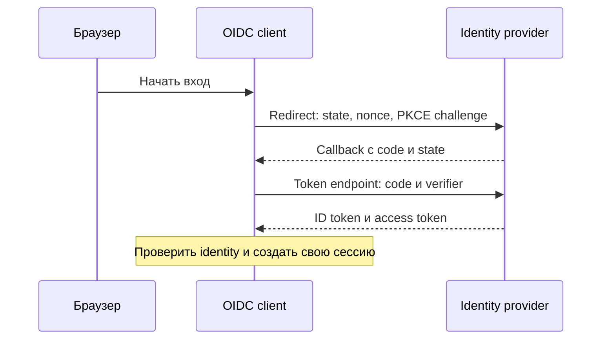

# OAuth 2.0 и OpenID Connect

OAuth отвечает на делегированный доступ к API, OIDC — на результат входа пользователя. Различайте code, access token, ID token и refresh token: они имеют разных получателей и разные проверки.

## Термины в этой статье

- **audience** — получатель, для которого выпущен токен.
- **endpoint** — конкретный адрес службы или сторона соединения.
- **PKCE** — связь между начальным OAuth-запросом и обменом кода через одноразовый секрет клиента.
- **replay** — повтор ранее переданного сообщения, который может снова вызвать действие.
- **issuer** — сторона, которая выпустила токен или сертификат.
- **rotation** — замена ключа или секрета с прекращением использования предыдущего.
- **scope** — заявленный объём доступа, который всё ещё требует проверки политикой сервера.

OAuth 2.0 позволяет пользователю разрешить приложению доступ к защищённому ресурсу; сам по себе он не задаёт протокол входа. OpenID Connect (OIDC) добавляет проверяемый результат аутентификации (ID Token), получение сведений о пользователе (UserInfo) и поиск настроек поставщика (discovery).

## Роли и токены

- **resource owner** — владелец ресурса, обычно пользователь, разрешающий доступ;
- **client** — приложение, запрашивающее разрешение;
- **authorization server** — сервер авторизации, проверяющий пользователя, получающий согласие и выдающий токены;
- **resource server** — сервер API, проверяющий access token для доступа к ресурсу.

ID Token сообщает приложению результат входа и сведения о пользователе; его нельзя использовать вместо access token для произвольного API. Access token предназначен серверу ресурса. Refresh token предъявляют серверу авторизации для получения нового access token.

## Рекомендуемый redirect flow

Используйте Authorization Code Grant с PKCE (`S256`) для public и современных confidential clients. `state` связывает response с browser transaction/CSRF defense; OIDC `nonce` связывает ID Token и защищает от replay. Redirect URI сравнивают строго с зарегистрированной. Implicit grant и Resource Owner Password Credentials не используйте: RFC 9700 считает их небезопасными/не рекомендует.

Backend callback должен однократно обменять code вместе с `code_verifier`, проверить issuer, client, redirect URI и protocol errors. Не отправляйте code/token в analytics и logs.

## Validation

Для JWT ID/access token проверяют signature/approved algorithm, issuer, audience, expiry/not-before и token type/purpose. Opaque access token проверяют по контракту issuer, например через introspection; JWT signature у него отсутствует. OIDC client дополнительно проверяет `nonce` и flow-specific claims. Keys получают из trusted issuer metadata/JWKS с cache и безопасной rotation; `kid` не является URL для произвольной загрузки.

Scopes ограничивают делегированный доступ, но не заменяют object-level authorization. Запрашивайте минимальные scopes/audiences. Refresh tokens ограничивайте grant-ом, защищайте, истекайте/отзывайте; public clients используют rotation или sender constraint для replay detection.

## Разбор на примере

Web-приложение начинает Code flow: сохраняет browser transaction, случайные state/nonce и PKCE verifier; отправляет challenge S256. После redirect сравнивает state, меняет одноразовый code с verifier через token endpoint и проверяет OIDC ID token, включая отправленный nonce. Для confidential client также требуется предусмотренная схема client authentication: PKCE её не отменяет.

Code без правильного verifier не должен успешно обмениваться. ID token адресован OIDC client и подтверждает authentication; ресурсное API принимает свой access token, а не произвольный ID token. Access token может быть opaque: resource server использует introspection/согласованную серверную проверку. Если access token — JWT, применяются проверки его JWT-профиля. Это исправляет опасное предположение, что любой OAuth token обязан быть подписанным JWT.

Refresh token `R1` меняется на `R2`. Повторное предъявление украденного `R1` позволяет обнаружить replay и отозвать соответствующий grant/token family по политике provider. Но два легитимных конкурентных refresh тоже могут выглядеть как reuse: клиенту нужен single-owner refresh и корректная обработка неясного сетевого исхода, а не бесконечное повторение.

Не связывайте accounts только по совпавшему email разных issuer. Проверенная пара issuer + subject имеет явный scope; account linking требует отдельной подтверждённой процедуры.

## Источники

- [OAuth 2.0 Security Best Current Practice, RFC 9700](https://www.rfc-editor.org/rfc/rfc9700)
- [OpenID Connect Core 1.0 with errata](https://openid.net/specs/openid-connect-core-1_0.html)
- [PKCE, RFC 7636](https://www.rfc-editor.org/rfc/rfc7636)

## Проверь себя

1. Можно ли предъявлять ID token вместо access token своему API?
2. Требует ли opaque access token проверки JWT signature?

Ответы

1. По умолчанию нет: у него другой получатель и purpose; API должен принимать предназначенный для него credential.

2. Нет: это не JWT. Примените introspection или контракт provider, включая active/audience/scope/expiry.

