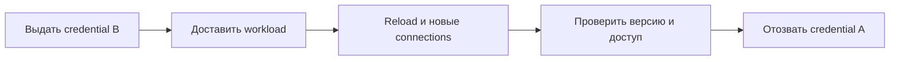

# Secrets management

Secret даёт возможность действовать от имени владельца. Управление им включает выдачу, ограничение прав, доставку, обновление и отзыв; удаление из файла не отзывает уже скопированный ключ.

## Термины в этой статье

- **credential** — предъявляемое доказательство личности: пароль, ключ, токен или сертификат.
- **identity** — подтверждённая личность пользователя или службы.
- **rotation** — замена ключа или секрета с прекращением использования предыдущего.
- **pool** — набор объектов, например соединений, которые используются повторно.

Secret — credential или cryptographic material, раскрытие которого даёт доступ: password, API key, private key, token, database credential. Его жизненный цикл важнее места хранения.

## Lifecycle

1. Генерировать cryptographically random с owner/purpose/expiry.
2. Хранить encrypted с access policy и audit.
3. Доставлять только workload identity, которому secret нужен.
4. Использовать без записи в logs, command line, crash dump или metrics.
5. Rotating без downtime через overlap/versioning.
6. Отзывать и удалять по policy; репетировать compromise response.

Не храните secrets в Git, container image, sample config или frontend bundle. Environment variables удобны, но могут попадать в process inspection, diagnostics и child processes; mounted file/agent/API имеют другие риски. Выбирайте delivery по platform threat model.

## Least privilege

Разные environments/services получают разные credentials; read и write scopes разделяют. Предпочитайте short-lived dynamic credentials/workload identity статическим ключам. Secret manager administrator не должен автоматически быть application/data administrator.

Application читает secret при startup или обновляет контролируемо. Не делайте request к secret manager на каждый business request без cache/failure design. Rotation включает dual-valid period, reload/reconnect, verification и отзыв старого значения.

## Утечка

Если secret попал в commit/log/chat, удаление строки недостаточно: считайте его раскрытым, отзовите/rotate, найдите access и downstream impact, очистите доступные копии согласно retention. Переписывание Git history — отдельная операция и не отменяет уже сделанные clones.

## Разбор на примере

Ротация DB credential без простоя: создать B с минимальными правами → доставить B workload → обновить connections → подтвердить использование B → отозвать A. Пока оба действуют, overlap должен быть ограничен. Некоторые connections переживают смену пароля; проверяйте contract БД/driver и pool lifetime, а не только загруженную переменную.

Если приложение не загрузило B и продолжает на A, немедленный отзыв A создаёт отказ. Если A уже скомпрометирован, продолжать длинный overlap нельзя: безопасность и доступность требуют явного решения и ограниченной процедуры восстановления. Автоматизация должна наблюдать принятую версию, но не значение секрета.

Утечка ключа в Git: сначала отозвать/rotate credential, затем проверить использование и убрать доступные копии по процедуре. История, forks, CI logs и clones могут содержать прежнее значение. Переписывание Git не возвращает секретность.

Environment variable может наследоваться дочерним процессом и попадать в diagnostics; файл может быть прочитан при неправильных permissions; secret API зависит от identity/network. Выбирают по threat model, а не по лозунгу «env безопаснее».

## Источники

- [OWASP Secrets Management Cheat Sheet](https://cheatsheetseries.owasp.org/cheatsheets/Secrets_Management_Cheat_Sheet.html)
- [Kubernetes Secrets good practices](https://kubernetes.io/docs/concepts/security/secrets-good-practices/)

## Проверь себя

1. Почему удаления ключа из HEAD недостаточно?
2. Как проверить успешную ротацию без логирования секрета?

Ответы

1. Копии могли остаться в истории и у других получателей; действующий credential надо отозвать.

2. Наблюдать идентификатор версии и успешное использование новых connections, затем отказ старого credential.

