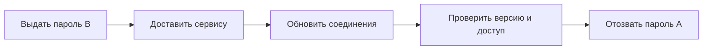

# Секреты: выдача, использование и отзыв

Пароль БД, API-ключ, секретный ключ и токен позволяют действовать от имени владельца. Секрет нужно не только спрятать в файле: важно ограничить его права, доставить нужному процессу, заменить и прекратить доверие при утечке. Удаление строки не отзывает уже скопированную возможность доступа.

## Что хранить вместе с секретом

У значения есть владелец, назначение, допустимые получатели и срок. Генерация использует криптографически стойкий источник, хранение — шифрование, правила доступа и журнал выдачи. Разным сервисам и средам нужны разные данные доступа: ключ тестовой среды не должен разрешать production.

Выдавайте минимальные права. Если процесс только читает данные, доступ на изменение ему не нужен. Короткоживущие данные доступа и проверка личности сервиса уменьшают время действия украденной копии. Администратор хранилища секретов не обязан автоматически иметь все права к данным приложения.

## Как доставить значение процессу

Переменная окружения удобна, но может попасть в диагностику, инспекцию процесса или дочерний процесс. Файл требует правильных прав и обновления. Запрос к специальному хранилищу требует доступности сети и надёжной проверки личности. Выбор зависит от того, кто может видеть процесс, файлы и диагностические данные в вашей среде.

Не помещайте реальные секреты в Git, образ контейнера, пример конфигурации или frontend. Не передавайте их в командной строке и не записывайте в журналы и метрики. Дамп процесса тоже может содержать секрет.

## Почему замена требует подтверждения

Сервис мог прочитать пароль при старте и продолжить работать со старым соединением. Загрузка нового значения в хранилище ещё не означает его использование. Плановая замена включает выдачу новой версии, обновление получателей, перезагрузку нужных соединений, проверку успешного доступа и отзыв предыдущей версии.

Период одновременной действительности снижает риск простоя при плановой смене. Если старый ключ уже украден, такой период сохраняет доступ атакующему: стратегия должна учитывать компрометацию. Ниже разобрана последовательность A→B и подтверждение применения.

Не обращайтесь к хранилищу на каждый бизнес-запрос без необходимости: оно станет общей зависимостью. Кэш должен иметь понятный срок, способ обновления и поведение при недоступности источника.

## Что делать после утечки

Если значение попало в commit или журнал, считайте копию доступной тем, кто мог его прочитать. Отзовите или замените значение, исследуйте использование и затронутые данные, затем очищайте доступные копии по правилам хранения. Переписывание Git-истории — отдельная операция: уже сделанные clone оно не удаляет. Подготовленный процесс отзыва полезнее уверенности, что секрет «никогда не утечёт».

## Разбор на примере

Сервис использует пароль БД A. Для плановой замены создаём B с нужными минимальными правами, доставляем его сервису, обновляем соединения, подтверждаем успешное использование B и отзываем A. В метриках можно показать идентификатор версии, но нельзя показывать значение.

Если сервис ещё использует A, ранний отзыв приведёт к ошибкам. Если A уже украден, долгое перекрытие сохранит доступ атакующему. Кроме того, готовые соединения могут пережить смену пароля: проверьте правила БД, драйвера и пула, а не только переменную конфигурации.

Если ключ попал в Git, его нужно отозвать или заменить до расчёта на удаление копий. История, forks, CI-журналы и чужие clone могут содержать прежнее значение. Переменная окружения может попасть в диагностику, файл — быть доступен при неверных правах, а API хранилища — зависеть от сети. Это разные условия доступа, а не универсальная иерархия безопасности.

## Источники

- [OWASP Secrets Management Cheat Sheet](https://cheatsheetseries.owasp.org/cheatsheets/Secrets_Management_Cheat_Sheet.html)
- [Kubernetes Secrets good practices](https://kubernetes.io/docs/concepts/security/secrets-good-practices/)

## Проверь себя

1. Почему удаления ключа из последнего commit недостаточно?
2. Как проверить замену, не выводя секрет в журнал?

Ответы

1. Копии могут остаться в истории, журналах и чужих репозиториях. Действующий доступ нужно отозвать.

2. Наблюдать идентификатор версии, успешное новое подключение и прекращение действия прежнего значения.

