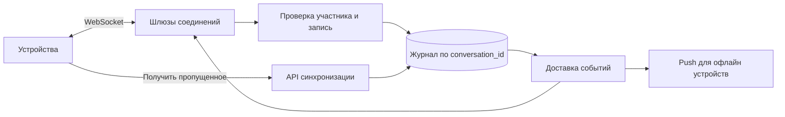

# Чат: запись, доставка и восстановление

Отправить сообщение и показать его получателю — разные этапы. Надёжный чат сначала сохраняет сообщение, а затем доставляет по текущим соединениям и позволяет получить пропущенное после отключения.

## Как устроено

Клиент создаёт устойчивый ID сообщения. Сервер проверяет участие в беседе, сохраняет сообщение с номером порядка и только затем подтверждает. Повтор с тем же ID возвращает прежнее сообщение. WebSocket переносит данные по живому соединению, но не хранит историю.

Порядок обычно нужен внутри беседы, а не между всеми беседами мира. Получатель хранит последнюю непрерывно применённую позицию и при пропуске запрашивает продолжение журнала. «Записано», «доставлено устройству» и «прочитано» — разные статусы.

Состояние «пользователь онлайн» приблизительно: соединение может уже оборваться. Огромные группы требуют отдельного масштабирования доставки, поскольку один сохранённый текст превращается в множество отправок. Сквозное шифрование отдельно меняет возможности поиска, модерации и управления ключами.

## Разбор на конкретной нагрузке

КиБ — 1024 байта; МБ, ГБ и ТБ здесь обозначают миллион, миллиард и триллион байтов. Допущения учебного примера: 1 млн одновременно подключённых устройств, 20 млн сообщений в сутки, пик в 10 раз выше среднего. Это около 231 сообщений/с в среднем и 2 315/с на пике. При 1 КиБ на запись годовой журнал занимает примерно 7,5 ТБ до индексов и реплик. При трёх копиях только сообщения потребуют примерно 22,4 ТБ. Файлы считаем отдельно.

### Порядок и повтор отправки

Храним `messages(conversation_id, seq, sender_id, client_message_id, body)` с уникальностью `(conversation_id, seq)` и `(conversation_id, sender_id, client_message_id)`. В короткой транзакции блокируем строку беседы, увеличиваем её `last_seq`, вставляем сообщение и событие таблицу исходящих событий outbox. Подтверждаем только после завершения транзакции. Это простой стартовый вариант; отдельный упорядоченный журнал нужен после измерения предела горячей беседы.

Почему нельзя взять генератор последовательностей PostgreSQL (sequence) и считать отсутствие номера потерей? Генератор sequence допускает пропуски при откате транзакции. Если синхронизация требует непрерывных номеров, счётчик беседы должен обновляться транзакционно. Если номера просто возрастают, API отдаёт продолжение и явную границу обработанного журнала: клиент не делает вывод по арифметическому пропуску.

### Доставка и возобновление

Получатель сохраняет последний непрерывно применённый `seq`. При получении 105 после 103 запрашивает `GET /conversations/c/messages?after=103`; повтор 103 не создаёт вторую карточку. Подтверждение сервера означает «записано», доставка устройству и прочтение человеком — разные статусы. Для редактирования передаём версию сообщения, для удаления — событие удаления, доступное офлайн-клиенту в пределах окна синхронизации.

Сбой: сервер записал сообщение, но соединение оборвалось перед ответом. Клиент повторяет тот же `client_message_id` и получает прежние `seq` и результат. Новый ID создал бы второе сообщение. При падении шлюза журнал остаётся, клиент подключается к другому шлюзу и восстанавливает историю. Большой канал требует отдельного масштабирования доставки: 2 000 сообщений/с × 100 000 получателей — 200 млн попыток доставки/с, что невозможно скрыть добавлением одной реплики БД.

## Источник механизма

[PostgreSQL 18: sequence gaps](https://www.postgresql.org/docs/18/functions-sequence.html). Числа в примере учебные; реальную нагрузку и размеры нужно измерить.

## Проверь себя

1. Почему WebSocket не заменяет журнал?
2. Что делать с повтором после потерянного подтверждения?
3. Нужен ли порядок между разными беседами?

Ориентиры для ответа

1. Он переносит данные по живому соединению, но не хранит пропущенные сообщения и не доказывает их сохранение.
2. Вернуть ранее созданное сообщение по устойчивому ID, сохранив тот же номер.
3. Обычно нет: он добавляет координацию без пользовательской пользы.

