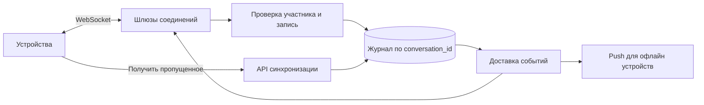

# Chat

## Требования

1:1/group messages, realtime online delivery, offline sync, delivery/read receipts, edit/delete, attachments и push. Уточнить member count, per-conversation ordering, retention/search, multi-device и encryption.

## API и модель

Client создаёт stable `client_message_id`; server возвращает `(conversation_id, sequence/message_id)`. Membership/role и message log — authoritative (владеющий достоверным состоянием). Cursor sync запрашивает records после last acknowledged sequence, а не полагается только на WebSocket.

## Путь записи

Gateway authenticates persistent connection → chat service checks membership/idempotency → assigns order в conversation shard/partition → durable append → ack sender → fan-out (раздача одного действия многим получателям) event online gateways, unread projection (производная модель для чтения) и push service. Ack до durable append рискует потерять message.

## Ordering и sharding

Total global order не нужен; one ordered writer/partition per conversation проще. Hot giant room ограничивает partition (раздел журнала или данных; при network partition — разрыв связи): можно shard (часть данных у отдельного владельца) fan-out/read delivery, сохраняя message sequence у authority. Client reorders/buffers по sequence и умеет gap sync.

## Presence и fan-out

Presence — ephemeral lease/heartbeat и допускает staleness; не храните её как durable truth. Online connection registry маршрутизирует по user/device. Для малых groups fan-out on write; для огромных channels subscribers pull/fan-out hierarchy, иначе write amplification огромен.

## Отказы

Reconnect повторяет unacked message с тем же ID. Duplicate delivery безопасна. Gateway crash восстанавливается через cursor. Push может прийти после realtime delivery; collapse/dedup — UX optimization. Edit/delete — новые versioned events, offline clients должны их применить.

## Trade-offs/security

Read receipts создают write amplification и privacy choices. End-to-end encryption меняет server search/moderation/multi-device key management. Наблюдайте connection count, send queue/backpressure, append latency (срок ответа), delivery gap и sync lag.

## Разбор на конкретной нагрузке

Допущения учебного примера: 1 млн одновременно подключённых устройств, 20 млн сообщений в сутки, пик в 10 раз выше среднего. Это около 231 сообщений/с в среднем и 2 315/с на пике. При 1 KiB на запись годовой журнал занимает примерно 7,5 TB до индексов и реплик. При трёх копиях только сообщения потребуют примерно 22,4 TB. Файлы считаем отдельно.

### Порядок и повтор отправки

Храним `messages(conversation_id, seq, sender_id, client_message_id, body)` с уникальностью `(conversation_id, seq)` и `(conversation_id, sender_id, client_message_id)`. В короткой транзакции блокируем строку беседы, увеличиваем её `last_seq`, вставляем сообщение и событие Outbox (события, сохранённые вместе с бизнес-изменением). Подтверждаем только после commit (фиксация результата, который считается подтверждённым). Это простой стартовый вариант; отдельный упорядоченный журнал нужен после измерения предела горячей беседы.

Почему нельзя взять PostgreSQL sequence и считать отсутствие номера потерей? Sequence допускает пропуски при rollback (отмена локальной транзакции или возврат старой версии). Если синхронизация требует непрерывных номеров, счётчик беседы должен обновляться транзакционно. Если номера просто возрастают, API отдаёт продолжение и явную границу обработанного журнала: клиент не делает вывод по арифметическому пропуску.

### Доставка и возобновление

Получатель сохраняет последний непрерывно применённый `seq`. При получении 105 после 103 запрашивает `GET /conversations/c/messages?after=103`; повтор 103 не создаёт вторую карточку. Подтверждение сервера означает «записано», доставка устройству и прочтение человеком — разные статусы. Для редактирования передаём версию сообщения, для удаления — событие удаления, доступное офлайн-клиенту в пределах окна синхронизации.

Сбой: сервер записал сообщение, но соединение оборвалось перед ответом. Клиент повторяет тот же `client_message_id` и получает прежние `seq` и результат. Новый ID создал бы второе сообщение. При падении шлюза журнал остаётся, клиент подключается к другому шлюзу и восстанавливает историю. Большой канал требует отдельного масштабирования доставки: 2 000 сообщений/с × 100 000 получателей — 200 млн попыток доставки/с, что невозможно скрыть добавлением одной реплики БД.

## Источник механизма

[PostgreSQL 18: sequence gaps](https://www.postgresql.org/docs/18/functions-sequence.html). Числа и topology в примерах — учебные допущения, не параметры этой системы.

## Проверь себя

1. Почему WebSocket не заменяет журнал?
2. Что делать с повтором после потерянного подтверждения?
3. Нужен ли порядок между разными беседами?

Ориентиры для ответа

1. Он переносит данные по живому соединению, но не хранит пропущенные сообщения и не доказывает их сохранение.
2. Вернуть ранее созданное сообщение по устойчивому ID, сохранив тот же номер.
3. Обычно нет: он добавляет координацию без пользовательской пользы.

