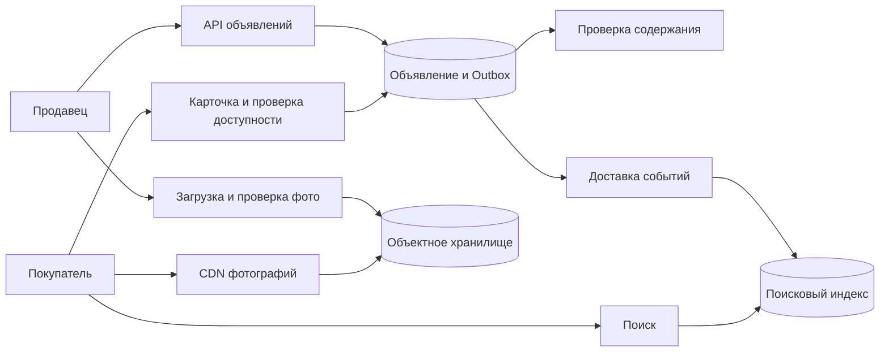

# Сервис объявлений: публикация и поиск

Объявление проходит создание, проверку и публикацию. Основная БД хранит разрешённое состояние, поиск держит удобную копию, а фотографии хранятся отдельно от строк объявления.

## Как устроено

У объявления есть владелец, состояние и версия содержания. Результат модерации относится именно к проверенной версии: изменение текста после проверки должно требовать нового решения. Переход состояния и событие об изменении сохраняют вместе, чтобы поиск мог восстановиться после отказа.

Поисковый индекс нужен для текста, фильтров и ранжирования. Он может отставать; карточка проверяет текущую видимость в достоверном источнике. Эта проверка не удаляет уже показанный поисковый фрагмент, поэтому строгие требования удаления должны охватывать выдачу и фото тоже.

Создание индекса — отдельная процедура со снимком и последующими изменениями. Успех HTTP не означает, что объявление уже видно в поиске: договор определяет допустимую задержку и способ показать её пользователю.

[Outbox](../../backend-patterns/transactional-outbox.md) — таблица намерений отправить события, сохранённая в той же транзакции, что и изменение данных. Отдельный исполнитель доставляет эти события после сохранения.

## Архитектура с проверяемыми допущениями

КиБ — 1024 байта; МБ, ГБ и ТБ здесь обозначают миллион, миллиард и триллион байтов. Учебный масштаб: 10 млн активных объявлений, 1 млн изменений в сутки, 100 млн просмотров карточек в сутки. Это 11,6 изменений/с и 1 157 чтений/с в среднем; при пике ×10 — 116 и 11 570/с. Карточка 2 КиБ даёт примерно 20,5 ГБ без индексов; пять фото по 500 КиБ на объявление — уже около 25,6 ТБ. Фото определяют стоимость хранения, чтения карточек — нагрузку API.

### Публикация после модерации

`ads(id, owner_id, status, content_version, approved_version)` хранит состояние. Ответ модерации содержит именно проверенную `content_version`. Если продавец изменил текст после отправки, результат проверки версии 7 не разрешает публиковать версию 8. Обновляем условно: `WHERE content_version = 7 AND status = 'pending'`. Ноль изменённых строк означает устаревший результат, а не временную ошибку для бесконечного повтора.

Изменение цены можно проверять отдельным правилом, изменение текста/фото — возвращать на модерацию. Это решение продукта; инвариант формулируем явно: пользователь видит только одобренное содержание. Транзакция смены статуса записывает Outbox; отправка события отдельно от завершения транзакции оставляет дыру при падении процесса.

### Перестроение поиска без отката версий

Проекция — копия для быстрых запросов. Документ несёт `ad_id` и `content_version`; обработчик не заменяет версию 9 на запоздавшую 8. Для полного восстановления строим новый индекс: снимок данных плюс журнал изменений после согласованной позиции снимка, затем догоняем журнал и переключаем указатель на новый индекс. События удаления должны дойти до нового индекса; одного копирования опубликованных строк недостаточно.

Поиск отдаёт кандидатов, карточка проверяет текущую видимость. Это предотвращает раскрытие уже закрытого объявления, но сами поисковые сниппеты тоже могут содержать удалённый текст: для строгого удаления нужны фильтрация выдачи по актуальному статусу и срок очистки индекса/CDN. Для стабильных страниц Elasticsearch использует `search_after` с устойчивым дополнительным ключом; PIT (point in time) — зафиксированный снимок поиска на ограниченное время. [Документация Elasticsearch](https://www.elastic.co/docs/reference/elasticsearch/rest-apis/paginate-search-results).

Сбой: индексатор не работает 30 минут. API сохраняет объявления, пользователю показывает «опубликовано, появляется в поиске» только если такой контракт принят. Контролируем возраст самого старого необработанного события, место Outbox и скорость догоняющей обработки. Нельзя объявить систему здоровой только по успешным HTTP-ответам.

## Проверь себя

1. Почему успешная модерация старой версии опасна?
2. Можно ли восстановить поиск только из текущих строк?
3. Что означает успех публикации?

Ориентиры для ответа

1. Она ничего не говорит о новом тексте; нужен условный переход по проверенной версии.
2. Да для начального снимка, но изменения и удаления во время построения нужно догнать из журнала.
3. Сохранённое состояние и намерение индексации; видимость в поиске — отдельная измеряемая гарантия.

