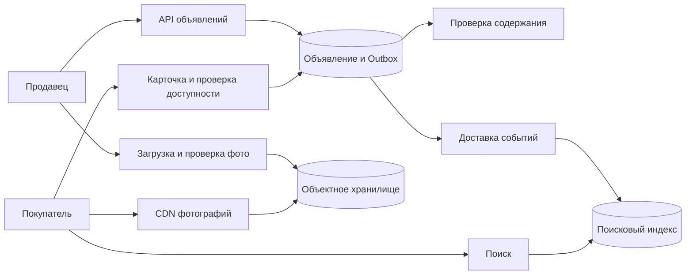

# Classifieds ads

## Требования

Создать draft, загрузить photos, отправить на moderation, publish/pause/sell/expire; искать и фильтровать по category/location/price; открыть detail; связаться с seller. Уточнить paid promotion, fraud, geo, legal retention (срок хранения) и freshness search.

## Модель предметной области

Authoritative (владеющий достоверным состоянием) relational model хранит ad aggregate, owner, category attributes, price/currency, location, lifecycle (кто создаёт, останавливает и освобождает ресурс) version и media references. State machine запрещает переходы в обход moderation. Search document и caches — rebuildable projections.

## Путь записи

API authorizes seller и idempotently меняет draft → media upload service проверяет files → moderation workflow (automated/manual) → transaction публикует state + outbox (события, сохранённые вместе с бизнес-изменением) → indexer строит search document → cache/CDN invalidation. Event содержит ad ID/version; projection (производная модель для чтения) игнорирует старую version.

## Путь чтения и поиска

Search engine выполняет text/filter/geo/ranking и возвращает IDs + summary/version. Detail service batch/point читает authoritative/cache data и обязательно проверяет текущий status/visibility. Cursor содержит score/sort key + ID + query/index version.

## Масштабирование

Partition (раздел журнала или данных; при network partition — разрыв связи) primary data по ad/owner region согласно access и compliance. Category-specific attributes можно моделировать typed tables/JSON with validated schema; бесконтрольный EAV усложняет constraints/query planning. Images идут object storage/CDN, не через DB blobs.

## Failures и consistency

Index lag означает, что новый ad позже появится, а снятый может временно остаться candidate (кандидат на лидерство); final detail filter не позволяет открыть запрещённое. Outbox закрывает dual write, DLQ/reindex/reconciliation восстанавливают projection. Moderation/provider outage оставляет explicit pending, не публикует fail-open.

## Trade-offs/security

Denormalized search ускоряет discovery ценой eventual consistency (согласованность наблюдаемых значений и порядка). Real-time indexing дороже batch. Защитите contact data, rate-limit scraping/spam, проверяйте ownership/media/price changes, audit moderation. Метрики: publish-to-search age, stale candidate rate, moderation queue, zero-result/search p99 (время, в которое укладывается 99% наблюдений) и fraud signals.

## Архитектура с проверяемыми допущениями

Учебный масштаб: 10 млн активных объявлений, 1 млн изменений в сутки, 100 млн просмотров карточек в сутки. Это 11,6 изменений/с и 1 157 чтений/с в среднем; при пике ×10 — 116 и 11 570/с. Карточка 2 KiB даёт примерно 20,5 GB без индексов; пять фото по 500 KiB на объявление — уже около 25,6 TB. Фото определяют стоимость хранения, чтения карточек — нагрузку API.

### Публикация после модерации

`ads(id, owner_id, status, content_version, approved_version)` хранит состояние. Ответ модерации содержит именно проверенную `content_version`. Если продавец изменил текст после отправки, результат проверки версии 7 не разрешает публиковать версию 8. Обновляем условно: `WHERE content_version = 7 AND status = 'pending'`. Ноль изменённых строк означает устаревший результат, а не временную ошибку для бесконечного повтора.

Изменение цены можно проверять отдельным правилом, изменение текста/фото — возвращать на модерацию. Это решение продукта; инвариант формулируем явно: пользователь видит только одобренное содержание. Транзакция смены статуса записывает Outbox; отправка события отдельно от commit (фиксация результата, который считается подтверждённым) оставляет дыру при падении процесса.

### Перестроение поиска без отката версий

Проекция — копия для быстрых запросов. Документ несёт `ad_id` и `content_version`; обработчик не заменяет версию 9 на запоздавшую 8. Для полного восстановления строим новый индекс: снимок данных плюс журнал изменений после согласованной позиции снимка, затем догоняем журнал и переключаем указатель на новый индекс. События удаления должны дойти до нового индекса; одного копирования опубликованных строк недостаточно.

Поиск отдаёт кандидатов, карточка проверяет текущую видимость. Это предотвращает раскрытие уже закрытого объявления, но сами поисковые сниппеты тоже могут содержать удалённый текст: для строгого удаления нужны фильтрация выдачи по актуальному статусу и срок очистки индекса/CDN. Для стабильных страниц Elasticsearch использует `search_after` с устойчивым дополнительным ключом; PIT фиксирует состояние поиска на ограниченное время. [Документация Elasticsearch](https://www.elastic.co/docs/reference/elasticsearch/rest-apis/paginate-search-results).

Сбой: индексатор не работает 30 минут. API сохраняет объявления, пользователю показывает «опубликовано, появляется в поиске» только если такой контракт принят. Контролируем возраст самого старого необработанного события, место Outbox и скорость догоняющей обработки. Нельзя объявить систему здоровой только по успешным HTTP-ответам.

## Проверь себя

1. Почему успешная модерация старой версии опасна?
2. Можно ли восстановить поиск только из текущих строк?
3. Что означает успех публикации?

Ориентиры для ответа

1. Она ничего не говорит о новом тексте; нужен условный переход по проверенной версии.
2. Да для начального снимка, но изменения и удаления во время построения нужно догнать из журнала.
3. Сохранённое состояние и намерение индексации; видимость в поиске — отдельная измеряемая гарантия.

