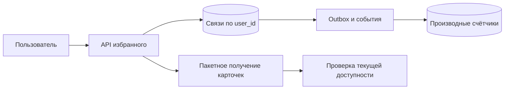

# Избранное: связь, список и счётчик

Избранное хранит факт «пользователь сохранил объект». Повтор добавления не должен создавать вторую связь, а производный счётчик не должен увеличиваться от каждой повторной доставки.

## Как устроено

Пара user_id,item_id уникальна. PUT устанавливает наличие связи, DELETE — отсутствие. Событие создаётся только если состояние действительно изменилось. Авторизованный пользователь определяется сервером, а не произвольным ID в пути.

Для списка нужны устойчивый порядок и продолжение. Время дополняют ID, а карточки получают пакетом, чтобы избежать отдельного сетевого вызова для каждого элемента. Удалённые или запрещённые объекты фильтруют по актуальному состоянию.

Порядок разных намерений — отдельная гарантия. Потерянное старое добавление, повторившееся после нового удаления, снова установит связь. Если это недопустимо, команды получают версии либо клиент дожидается результата перед следующим изменением.

[Outbox](../../backend-patterns/transactional-outbox.md) — таблица намерений отправить события, сохранённая в той же транзакции, что и изменение данных. Отдельный исполнитель доставляет эти события после сохранения.

## Конкретная схема и расчёт

КиБ — 1024 байта; МБ, ГБ и ТБ здесь обозначают миллион, миллиард и триллион байтов. Допустим, 10 млн пользователей имеют в среднем 100 избранных объектов: 1 млрд связей. При учебной оценке 64 байта на запись это 64 ГБ только полезной модели; строки, индексы, резерв места и реплики считаем отдельно. 20 млн добавлений/удалений в сутки — 231 операция/с в среднем, пик ×10 — 2 315/с.

### Изменение состояния без двойного счётчика

В одной транзакции выполняем `INSERT ... ON CONFLICT DO NOTHING RETURNING item_id`. Только если вернулась новая строка, записываем событие `favorite_added`. Повтор PUT не создаёт второе событие. Для DELETE событие создаём только по действительно удалённой строке. Получатель всё равно проверяет `event_id`: доставка одного события может повториться.

Два разных намерения пользователя — «добавить», затем «удалить» — нельзя слить одним ключом идемпотентности. Потерянный старый PUT, повторённый после нового DELETE, снова добавит связь: идемпотентность одного метода не задаёт порядок разных операций. Для строгого желаемого состояния передаём версию/номер команды устройства, либо клиент ждёт результата перед следующим изменением.

### Страница без OFFSET

Для порядка по времени используем `(created_at, item_id)` и запрос `WHERE user_id=$1 AND (created_at,item_id)<($2,$3) ORDER BY created_at DESC,item_id DESC LIMIT 51`. Время без ID не уникально. Курсор подписывается или проверяется как недоверенный ввод и связывается с пользователем/фильтром. Это стабильное продолжение по ключу, но не снимок: новый элемент попадёт до текущего курсора, удалённый исчезнет.

Карточки получаем пакетом, иначе 50 элементов дают 50 сетевых вызовов. Если часть недоступна, продолжаем чтение связей с ограничением числа просмотренных кандидатов; курсор отражает последний просмотренный ключ, а не последний показанный. Сбой после завершения транзакции и до ответа: повтор возвращает уже существующее состояние; производный счётчик догоняет Outbox. После восстановления сверяем сумму с исходными связями.

## Источник механизма

[PostgreSQL 18: INSERT ON CONFLICT](https://www.postgresql.org/docs/18/sql-insert.html). Числа в примере учебные; реальную нагрузку и размеры нужно измерить.

## Проверь себя

1. Почему повтор PUT не должен увеличивать счётчик?
2. Зачем ID в курсоре?
3. Гарантирует ли идемпотентность порядок PUT и DELETE?

Ориентиры для ответа

1. Реальная вставка происходит однажды; событие создаётся только при изменении связи.
2. Несколько записей имеют одинаковое время; ID задаёт однозначный порядок.
3. Нет, для последовательных намерений нужен отдельный контракт порядка.

