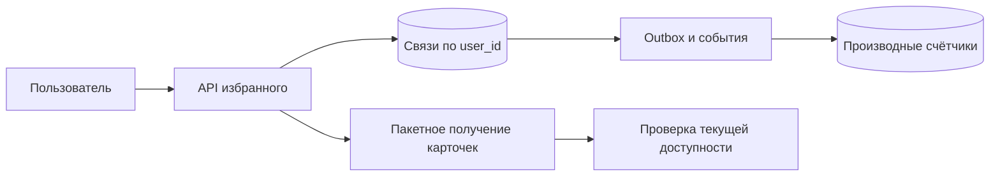

# Favorites

## Требования

Добавить/удалить item из favorites, проверить состояние, вывести список с pagination и optional count. Уточнить privacy, ordering, item deletion, folders/tags и read-after-write.

## API и модель

Идемпотентный resource contract (договорённость о поведении и гарантиях):

```text
PUT    /users/{u}/favorites/{item}
DELETE /users/{u}/favorites/{item}
GET    /users/{u}/favorites?cursor=...
```

Table `favorites(user_id, item_id, created_at)` имеет primary/unique `(user_id, item_id)` и index для listing `(user_id, created_at DESC, item_id DESC)`. Server берёт user из authenticated subject, не доверяет path без authorization.

## Пути запросов

Write использует `INSERT ... ON CONFLICT DO NOTHING`/`DELETE`, затем outbox (события, сохранённые вместе с бизнес-изменением) обновляет derived total/recommendations. Read keyset-страничит relation и batch hydrate-ит current item data, фильтруя deleted/inaccessible items.

## Масштабирование

Shard (часть данных у отдельного владельца) по `user_id` для основного listing. Reverse query «сколько users добавили item» требует отдельного index/aggregate и может быть hot для popular item. Exact synchronous counter создаёт contention; eventual sharded counter обычно достаточен для UI.

## Отказы

Retry PUT/DELETE безопасен по resource semantics. Crash после DB commit (фиксация результата, который считается подтверждённым) до event закрывает outbox. Item deletion оставляет tombstone/async cleanup; read path не должен показывать его из stale cache. Reconciliation (сверка и устранение расхождений) пересчитывает derived counts.

## Компромиссы

Strong read-after-write направляет session на primary/минимальную version, eventual replica/cache дешевле. Хранить snapshot item в favorite ускоряет read, но создаёт stale duplication; чаще hydrate authoritative (владеющий достоверным состоянием) item.

## Observability/security

Write conflict/error, listing p99 (время, в которое укладывается 99% наблюдений), hydrate miss, projection (производная модель для чтения) lag и cleanup backlog (накопившаяся необработанная работа). Favorites — пользовательские данные: export/delete/retention и access audit входят в design.

## Конкретная схема и расчёт

Допустим, 10 млн пользователей имеют в среднем 100 избранных объектов: 1 млрд связей. При учебной оценке 64 B на запись это 64 GB только полезной модели; строки, индексы, резерв места и реплики считаем отдельно. 20 млн добавлений/удалений в сутки — 231 операция/с в среднем, пик ×10 — 2 315/с.



### Изменение состояния без двойного счётчика

В одной транзакции выполняем `INSERT ... ON CONFLICT DO NOTHING RETURNING item_id`. Только если вернулась новая строка, записываем событие `favorite_added`. Повтор PUT не создаёт второе событие. Для DELETE событие создаём только по действительно удалённой строке. Consumer (потребитель работы или контракта) всё равно проверяет `event_id`: доставка одного события может повториться.

Два разных намерения пользователя — «добавить», затем «удалить» — нельзя слить одним ключом идемпотентности. Потерянный старый PUT, повторённый после нового DELETE, снова добавит связь: идемпотентность одного метода не задаёт порядок разных операций. Для строгого желаемого состояния передаём версию/номер команды устройства, либо клиент ждёт результата перед следующим изменением.

### Страница без OFFSET

Для порядка по времени используем `(created_at, item_id)` и запрос `WHERE user_id=$1 AND (created_at,item_id)<($2,$3) ORDER BY created_at DESC,item_id DESC LIMIT 51`. Время без ID не уникально. Курсор подписывается или проверяется как недоверенный ввод и связывается с пользователем/фильтром. Это стабильное продолжение по ключу, но не снимок: новый элемент попадёт до текущего курсора, удалённый исчезнет.

Карточки получаем пакетом, иначе 50 элементов дают 50 сетевых вызовов. Если часть недоступна, продолжаем чтение связей с ограничением числа просмотренных кандидатов; курсор отражает последний просмотренный ключ, а не последний показанный. Сбой после commit и до ответа: повтор возвращает уже существующее состояние; производный счётчик догоняет Outbox. После восстановления сверяем сумму с исходными связями.

## Источник механизма

[PostgreSQL 18: INSERT ON CONFLICT](https://www.postgresql.org/docs/18/sql-insert.html). Числа и topology в примерах — учебные допущения, не параметры этой системы.

## Проверь себя

1. Почему повтор PUT не должен увеличивать счётчик?
2. Зачем ID в курсоре?
3. Гарантирует ли идемпотентность порядок PUT и DELETE?

<details>
<summary>Ориентиры для ответа</summary>

1. Реальная вставка происходит однажды; событие создаётся только при изменении связи.
2. Несколько записей имеют одинаковое время; ID задаёт однозначный порядок.
3. Нет, для последовательных намерений нужен отдельный контракт порядка.

</details>
