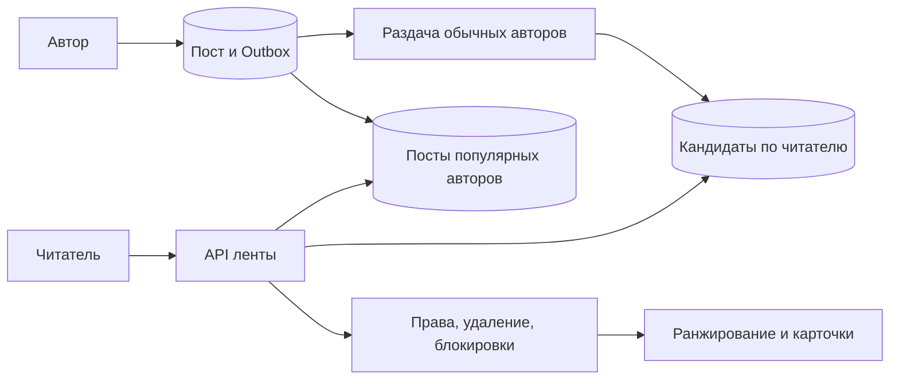

# Feed

## Требования

Показать posts от подписок/рекомендаций с ranking, cursor pagination, privacy/delete и freshness. Уточнить chronological vs ranked, follow graph scale, celebrity accounts, ads, read history и consistency (согласованность наблюдаемых значений и порядка) после unfollow/delete.

## Fan-out alternatives

- Fan-out (раздача одного действия многим получателям) on write: при publish вставить post ID в inbox (записи уже применённых событий для защиты от повторов) каждого follower (реплика, следующая журналу лидера). Read быстрый, write amplification огромен у celebrities, delete/privacy требуют массовой correction.
- Fan-out on read: запрос собирает recent posts followees и rank-ит. Writes дешёвые, reads fan-out/merge дорогие.
- Hybrid: обычные authors push, celebrities pull и merge при read.

## Архитектура

Post service commit-ит content + outbox (события, сохранённые вместе с бизнес-изменением). Fan-out workers обновляют per-user feed candidates idempotently. Read service получает candidates, фильтрует текущую visibility/block/delete, hydrate-ит posts, rank-ит и возвращает opaque cursor с ranking/version context.

Feed cache хранит IDs/score, не копии всей сущности. Source posts и graph остаются authoritative (владеющий достоверным состоянием). Final visibility check нужен, потому что асинхронная projection (производная модель для чтения) отстаёт.

## Pagination и ranking

Offset нестабилен при новых posts. Cursor содержит score/time + unique ID и, для reproducibility, model/session epoch (номер поколения). Строго стабильная страница конфликтует со свежестью; выберите snapshot-like session или разрешите controlled duplicates/gaps.

## Failures/scale

At-least-once fan-out создаёт duplicate candidate (кандидат на лидерство) — unique `(user, post)`/version. Queue lag ухудшает freshness, но не должен ломать publish. Celebrity event разделяется на batches с checkpoints/backpressure. Rebuild feed из post log/follow graph должен быть возможен.

## Компромиссы

Precompute снижает read latency (срок ответа) ценой storage/write. Online ranking свежее и дороже. Наблюдайте publish-to-visible latency, candidate/hydration misses, fan-out lag, hot authors и privacy correction time.

## Масштаб и схема

Учебные допущения: 5 млн активных читателей, 20 открытий ленты в сутки, 1 млн публикаций, 200 подписчиков у обычного автора. Получаем 100 млн чтений/сутки ≈ 1 157/с, пик ×10 ≈ 11 570/с. Предрасчёт создаёт до 200 млн ссылок/сутки. По 24 B и хранении 7 дней — 33,6 GB сырых ссылок без индексов. Один автор с 10 млн подписчиков меняет расчёт сильнее среднего.

### Раздача с возобновлением

Задача `(post_id, graph_snapshot, next_follower_cursor)` читает подписчиков пакетами. Вставка `(user_id, post_id)` уникальна; checkpoint (сохранённая позиция завершённой обработки) сохраняется после вставок. При падении пакет повторяется безопасно. Не держим весь список подписчиков в RAM. Снимок графа делает состав получателей понятным; если снимка нет, явно принимаем изменение подписок во время раздачи.

Подписка после публикации решается отдельным заполнением истории. Отписка, блокировка и удаление проверяются при чтении по актуальным правам: запоздалая задача раздачи не должна вернуть запрещённый пост. Кандидат в ленте не является разрешением доступа.

### Ранжирование и страницы

Если score меняется между страницами, курсор `score,id` сам по себе не предотвращает повторы/пропуски. Практический вариант — сессия выдачи: на первое чтение фиксируем ограниченный набор кандидатов и версию модели, выдаём курсор `(session_id, position)` с TTL (время жизни записи). Другой вариант — свежая выдача с допустимыми повторами и клиентским исключением увиденных ID. Выбор зависит от требований к свежести и памяти.

Сбой: consumer (потребитель работы или контракта) отстал на 15 минут. Публикация остаётся успешной, но новые посты ещё не видны. Для небольшого числа подписок API может временно собрать последние посты напрямую; такой запасной путь обязательно ограничиваем, иначе чтения добьют хранилище. Популярных авторов читаем при запросе: одна публикация не запускает 10 млн обязательных вставок.

## Источник механизма

[PostgreSQL 18: INSERT ON CONFLICT](https://www.postgresql.org/docs/18/sql-insert.html). Числа и topology в примерах — учебные допущения, не параметры этой системы.

## Проверь себя

1. Почему массовая раздача нужна не всем авторам?
2. Почему курсор по score нестабилен?
3. Где проверять блокировку?

Ориентиры для ответа

1. Стоимость зависит от числа подписчиков; для популярных выгоднее собрать посты при чтении.
2. Оценка меняется и перемещает пост через границу уже выданной страницы.
3. При окончательной выдаче; асинхронная копия графа может отставать.

