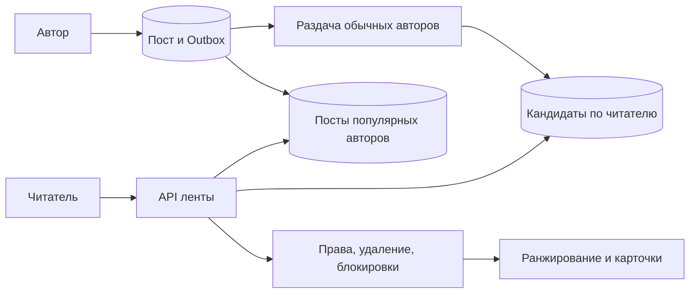

# Лента: подготовить кандидатов и проверить доступ

Лента показывает публикации подходящих авторов в выбранном порядке. Главный компромисс — заранее разложить записи по читателям или собирать их при открытии ленты.

## Как устроено

Для обычного автора можно после публикации записать ссылку в ленты подписчиков. Чтение быстро, но запись умножается на число получателей. Для автора с миллионами подписчиков удобнее получать его последние посты при чтении и объединять с подготовленными кандидатами.

Кандидат — ещё не разрешённый ответ. Перед выдачей проверяют удаление, блокировки и текущий доступ. Запоздавшая фоновая раздача не должна воскресить запрещённый пост. Положение задачи сохраняют, чтобы после падения безопасно повторить пакет.

Ранжирование может менять порядок между страницами. Для стабильной выдачи фиксируют ограниченную сессию результатов; для более свежей допускают повторы с клиентским исключением уже увиденных. Выбор определяется продуктом и стоимостью памяти.

[Outbox](../../backend-patterns/transactional-outbox.md) — таблица намерений отправить события, сохранённая в той же транзакции, что и изменение данных. Отдельный исполнитель доставляет эти события после сохранения.

## Масштаб и схема

КиБ — 1024 байта; МБ, ГБ и ТБ здесь обозначают миллион, миллиард и триллион байтов. Учебные допущения: 5 млн активных читателей, 20 открытий ленты в сутки, 1 млн публикаций, 200 подписчиков у обычного автора. Получаем 100 млн чтений/сутки ≈ 1 157/с, пик ×10 ≈ 11 570/с. Предрасчёт создаёт до 200 млн ссылок/сутки. По 24 байта и хранении 7 дней — 33,6 ГБ сырых ссылок без индексов. Один автор с 10 млн подписчиков меняет расчёт сильнее среднего.

### Раздача с возобновлением

Задача `(post_id, graph_snapshot, next_follower_cursor)` читает подписчиков пакетами. Вставка `(user_id, post_id)` уникальна; позиция завершённой обработки сохраняется после вставок. При падении пакет повторяется безопасно. Не держим весь список подписчиков в оперативной памяти. Снимок графа делает состав получателей понятным; если снимка нет, явно принимаем изменение подписок во время раздачи.

Подписка после публикации решается отдельным заполнением истории. Отписка, блокировка и удаление проверяются при чтении по актуальным правам: запоздалая задача раздачи не должна вернуть запрещённый пост. Кандидат в ленте не является разрешением доступа.

### Ранжирование и страницы

Если оценка ранжирования меняется между страницами, курсор `score,id` сам по себе не предотвращает повторы/пропуски. Практический вариант — сессия выдачи: на первое чтение фиксируем ограниченный набор кандидатов и версию модели, выдаём курсор `(session_id, position)` с срок жизни записи. Другой вариант — свежая выдача с допустимыми повторами и клиентским исключением увиденных ID. Выбор зависит от требований к свежести и памяти.

Сбой: получатель отстал на 15 минут. Публикация остаётся успешной, но новые посты ещё не видны. Для небольшого числа подписок API может временно собрать последние посты напрямую; такой запасной путь обязательно ограничиваем, иначе чтения добьют хранилище. Популярных авторов читаем при запросе: одна публикация не запускает 10 млн обязательных вставок.

## Источник механизма

[PostgreSQL 18: INSERT ON CONFLICT](https://www.postgresql.org/docs/18/sql-insert.html). Числа в примере учебные; реальную нагрузку и размеры нужно измерить.

## Проверь себя

1. Почему массовая раздача нужна не всем авторам?
2. Почему курсор по оценке ранжирования нестабилен?
3. Где проверять блокировку?

Ориентиры для ответа

1. Стоимость зависит от числа подписчиков; для популярных выгоднее собрать посты при чтении.
2. Оценка меняется и перемещает пост через границу уже выданной страницы.
3. При окончательной выдаче; асинхронная копия графа может отставать.

