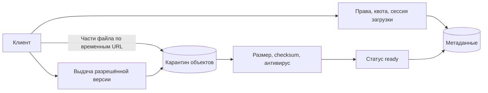

# File storage

## Требования

Upload/download больших files, resumable multipart, metadata, sharing/permissions, versioning, delete/retention и optional processing. Уточнить max size/types, checksum, malware policy, regional residency, durability/RPO и download bandwidth.

## Архитектура

Control plane API хранит metadata/authorization в database; bytes идут напрямую в object storage по short-lived scoped upload URL, чтобы application servers не стали bandwidth bottleneck. CDN обслуживает immutable/versioned downloads.

## Путь загрузки

1. Client создаёт upload session с idempotency key, size/type/checksum.
2. Service authorizes quota и выдаёт multipart URLs/object key.
3. Client загружает parts и сообщает completion.
4. Service проверяет storage metadata/checksum/size, атомарно переводит `uploading → processing`.
5. Async scanner/processor создаёт derived versions и публикует `ready`.

Object key должен быть opaque и tenant-scoped; client filename — metadata, не filesystem path. Download каждый раз проверяет authorization или использует очень короткий signed URL.

## Failures и cleanup

Crash оставляет orphan multipart/object либо metadata без object. Lifecycle (кто создаёт, останавливает и освобождает ресурс) abort-ит незавершённые uploads, reconciliation (сверка и устранение расхождений) сравнивает states. Completion duplicate idempotent (без второго эффекта при повторе одного намерения). Delete сначала закрывает access/помечает tombstone, затем async удаляет versions/CDN; legal hold меняет flow.

## Scale и trade-offs

Metadata shard (часть данных у отдельного владельца) по owner/object ID, listings используют deterministic cursor. Content-addressed dedup экономит bytes, но создаёт privacy/reference-count/encryption complexity. Cross-region replication повышает durability (сохранность подтверждённых данных при заявленных отказах) и cost/latency; consistency (согласованность наблюдаемых значений и порядка) metadata и object visibility проверяется у выбранного store.

## Security/observability

Ограничьте type/size, archive bombs, URL scope, encryption keys, scanning quarantine. Metrics upload success/time, orphan bytes, checksum failures, scan age, egress/CDN hit и storage errors.

## Схема и цена потока байтов

Учебные допущения: 1 млн файлов/сутки по 5 MB, хранение 30 дней. Это 5 TB новых данных/сутки и 150 TB без версий/копий. Если каждый файл скачивают трижды, 15 TB/сутки — около 174 MB/с среднего исходящего трафика; пик ×5 — 870 MB/с. Поэтому API выдаёт права и URL, а байты идут прямо в хранилище/CDN.

### Завершение загрузки — протокол

`uploads(id, owner, reserved_bytes, object_key, object_version, state)` хранит `uploading → verifying → ready | rejected`. Резерв квоты создаём до выдачи URL, срок освобождения задаём явно. Client completion не доказывает целостность: сервис проверяет фактический размер и checksum, а сканер работает с конкретной неизменяемой версией объекта. Иначе злоумышленник заменит файл после проверки.

Multipart позволяет повторить отдельную часть, но незавершённые части занимают место и требуют abort/lifecycle. ETag (HTTP-метка версии представления) нельзя универсально считать MD5 всего файла, особенно при multipart и некоторых видах шифрования. [Документация S3 multipart](https://docs.aws.amazon.com/AmazonS3/latest/userguide/mpuoverview.html).

### Удаление и потерянный доступ

Сначала транзакционно закрываем доступ в метаданных, затем удаляем конкретные версии и производные файлы. Уже выданный signed URL обычно действует до истечения срока: «удаление немедленно запрещает любой download» требует прокси-проверки, отзыва на слое выдачи или очень короткого TTL (время жизни записи). Шифрование и версии влияют на восстановление и стоимость удаления.

Сбой: storage успешно завершил multipart, API упал до смены состояния. Повтор completion проверяет тот же `object_key/version`, не создаёт второй объект. Периодическая сверка ищет зависшие сессии и объекты без активных метаданных. Для уборки нужен запас времени, чтобы не удалить ещё выполняемую загрузку. При отказе сканера новые файлы остаются в карантине: успешный upload не равен разрешённому download.

## Проверь себя

1. Почему приложение не проксирует каждый байт?
2. Достаточен ли ETag для проверки файла?
3. Можно ли немедленно отозвать уже выданный URL?

Ориентиры для ответа

1. Сетевой трафик масштабируется отдельно от обработки метаданных.
2. Нет, его смысл зависит от механизма загрузки; выбираем документированную checksum.
3. Не одним изменением строки БД; нужен контракт слоя выдачи.

