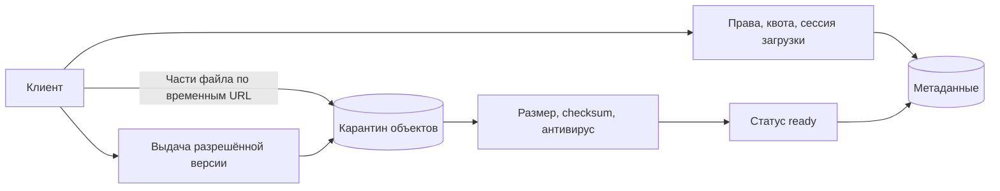

# Файловое хранилище: загрузка ещё не публикация

Файл проходит загрузку, проверку и разрешение доступа. Сообщение клиента «готово» не доказывает правильный размер, целостность и отсутствие опасного содержимого.

## Как устроено

API проверяет права и квоту, создаёт сессию и выдаёт временный адрес загрузки. Байты идут напрямую в объектное хранилище: сервер метаданных не обязан передавать весь поток через себя.

Проверяют конкретную неизменяемую версию объекта. Пока сканирование не закончено, файл остаётся в карантине. Иначе злоумышленник заменит файл после проверки. Незавершённые загрузки и части требуют уборки, но с достаточным запасом времени для ещё работающих клиентов.

При удалении сначала закрывают доступ в метаданных, затем убирают объекты и производные версии. Уже выданный подписанный URL может оставаться действительным до своего срока. Поэтому немедленный отзыв требует отдельного механизма на слое выдачи.

## Схема и цена потока байтов

МБ — миллион байтов, ТБ — триллион. Учебный пример: 1 млн файлов/сутки по 5 МБ, хранение 30 дней. Это 5 ТБ новых данных/сутки и 150 ТБ без версий/копий. Если каждый файл скачивают трижды, 15 ТБ/сутки — около 174 МБ/с среднего исходящего трафика; пик ×5 — 870 МБ/с. Поэтому API выдаёт права и URL, а байты идут прямо в хранилище/CDN.

### Завершение загрузки — протокол

`uploads(id, owner, reserved_bytes, object_key, object_version, state)` хранит `uploading → verifying → ready | rejected`. Резерв квоты создаём до выдачи URL, срок освобождения задаём явно. Сообщение клиента о завершении не доказывает целостность: сервис проверяет фактический размер и контрольную сумму, а сканер работает с конкретной неизменяемой версией объекта. Иначе злоумышленник заменит файл после проверки.

Загрузка частями (multipart) позволяет повторить отдельную часть, но незавершённые части занимают место и требуют явной отмены и уборки. ETag — метку версии представления — нельзя универсально считать MD5 всего файла, особенно при загрузке частями и некоторых видах шифрования. [Документация S3 multipart](https://docs.aws.amazon.com/AmazonS3/latest/userguide/mpuoverview.html).

### Удаление и потерянный доступ

Сначала транзакционно закрываем доступ в метаданных, затем удаляем конкретные версии и производные файлы. Уже выданный подписанный URL обычно действует до истечения срока: «удаление немедленно запрещает любую загрузку файла» требует прокси-проверки, отзыва на слое выдачи или очень короткого срок жизни записи. Шифрование и версии влияют на восстановление и стоимость удаления.

Сбой: хранилище успешно завершил загрузку частями, API упал до смены состояния. Повтор завершения проверяет тот же `object_key/version`, не создаёт второй объект. Периодическая сверка ищет зависшие сессии и объекты без активных метаданных. Для уборки нужен запас времени, чтобы не удалить ещё выполняемую загрузку. При отказе сканера новые файлы остаются в карантине: успешная загрузка файла не равна разрешению его скачивать.

## Проверь себя

1. Почему приложение не проксирует каждый байт?
2. Достаточен ли ETag для проверки файла?
3. Можно ли немедленно отозвать уже выданный URL?

Ориентиры для ответа

1. Сетевой трафик масштабируется отдельно от обработки метаданных.
2. Нет, его смысл зависит от механизма загрузки; выбираем контрольную сумму по правилам хранилища.
3. Не одним изменением строки БД; нужен контракт слоя выдачи.

