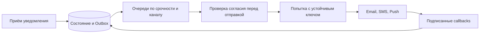

# Уведомления: принято, отправлено и доставлено

Сервис уведомлений превращает одно намерение в доставки по email, SMS или push. Принятие задачи сервисом не означает доставку человеку.

## Как устроено

Сохраняйте уведомление, версии шаблонов и отдельное состояние каждого канала. У каждой доставки устойчивый ключ, общий для повторов. Попытки хранят отдельно, чтобы не потерять историю ошибок.

Исполнители ограничены квотами поставщиков. Отказ SMS не должен занимать все ресурсы email. Просроченный одноразовый код не отправляют после восстановления: сначала проверяют пригодность и актуальные условия отправки.

Ответ поставщика может потеряться после отправки. Без его защиты от повторов или проверки результата нельзя обещать отсутствие второго SMS. Автоматическая смена поставщика тоже не переносит прежнюю историю. Входящие статусы проверяют, устраняют дубли и применяют только допустимые переходы.

[Outbox](../../backend-patterns/transactional-outbox.md) — таблица намерений отправить события, сохранённая в той же транзакции, что и изменение данных. Отдельный исполнитель доставляет эти события после сохранения.

## Разбор нагрузки и состояния

Учебный пример: 10 млн уведомлений/сутки, 1,5 канала на уведомление — 15 млн задач доставки, примерно 174/с в среднем. Пик ×20 — 3 472/с. Провайдер с квотой 1 000/с будет накапливать 2 472 задач/с; пяти минут такого пика достаточно для очереди 741 600 задач. Увеличение числа исполнителей не повышает квоту провайдера.

### Принято, отправлено, доставлено

`notification(id, recipient, template_version, state)` и `delivery(notification_id, channel, provider_key, status)` имеют уникальность по уведомлению/каналу. `accepted` означает сохранено, `provider_accepted` — провайдер принял, `delivered` — пришёл его статус. Для email этот статус не доказывает прочтение. Попытки с временем/кодом ответа храним отдельно, иначе повтор стирает расследуемую историю.

Стабильный `provider_key` относится к одной доставке, а не к отдельной попытке. Если поставщик не поддерживает дедупликацию или статус по ключу, падение после внешней отправки до сохранения местного результата оставляет неизвестный результат: повтор может отправить второе SMS. Переключение на другого провайдера не переносит его таблицу дедупликации; нельзя обещать отсутствие дублей при автоматической смене поставщика.

### Согласие и повтор событий

Маркетинговое сообщение проверяет актуальное согласие перед вызовом провайдера. После принятия провайдером отзыв не может гарантированно вернуть SMS назад. Транзакционные сообщения имеют отдельное основание и правила; это продуктовый/правовой контракт, а не одно поле bool для всех сообщений. Входящий статус проверяем по подписи, дедуплицируем по ID и применяем только допустимый переход: запоздавший `sent` не откатывает `delivered`.

Сбой: SMS-провайдер недоступен час. Его очередь и соединения изолированы от email; просроченный OTP переводим в `expired`, не доставляем код после окончания срока. Очередь ошибочных событий — задачи с владельцем, причиной и способом повторного запуска; перед повторным запуском снова проверяем срок и согласие. Метрика возраста самого старого срочного сообщения лучше количества ошибок HTTP.

## Источник механизма

[HTTP semantics: идемпотентность и неизвестный результат](https://www.rfc-editor.org/rfc/rfc9110.html#name-idempotent-methods). Числа в примере учебные; реальную нагрузку и размеры нужно измерить.

## Проверь себя

1. Почему accepted не равно delivered?
2. Почему смена провайдера может создать дубликат?
3. Нужно ли повторять OTP после восстановления?

Ориентиры для ответа

1. Это подтверждения разных этапов, каждое со своей границей ответственности.
2. Новый провайдер не знает о результате предыдущего.
3. Только пока он действителен; иначе повтор бесполезен и опасен.

