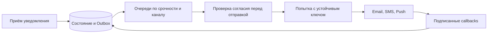

# Notification service

## Требования

Принять logical notification, применить preferences/consent, выбрать email/SMS/push/in-app, render template, доставить и показать status. Уточнить urgency, scheduling, dedup, quiet hours, unsubscribe, provider callback и regulatory audit.

## API и модель

`POST /notifications` принимает idempotency key, recipient, template version, variables, channels и schedule. Source of truth (основной достоверный источник данных) хранит notification state machine и per-channel attempt; preference/version фиксируется по выбранной business semantics.

## Путь записи

API валидирует/authorizes → transaction создаёт notification + outbox (события, сохранённые вместе с бизнес-изменением) → broker partition (раздел журнала или данных; при network partition — разрыв связи) key по notification/recipient → channel orchestrator проверяет актуальный consent → render → provider call с stable provider idempotency key → сохраняет attempt/status. Callback deduplicate-ится по provider event ID.

## Retries и ordering

Transient (временный, потенциально устранимый повтором) errors получают bounded (с явным конечным пределом) backoff/jitter; permanent invalid address уходит в terminal state. Retry queue/DLQ имеют owner и replay (повторное проигрывание сохранённых событий). Strict global order обычно не нужен; per-recipient priority/order конфликтует с parallelism и poison messages.

## Отказы

Crash после provider acceptance до local commit (фиксация результата, который считается подтверждённым) создаёт duplicate — используйте provider idempotency/status reconciliation (сверка и устранение расхождений). Отмена после enqueue требует check перед send. Broker lag у urgent channel алертится по oldest age, не только depth. Provider outage изолируется bulkhead/circuit breaker, fallback channel разрешён только product policy.

## Scale и trade-offs

Separate queues/pools по channel/priority защищают critical traffic. Template rendering можно cache-ить по version. Exactly-once внешней доставки обычно недостижимо: обещайте at-least-once attempt/effectively-once при provider support. In-app может быть durable feed, email — irreversible side effect.

## Observability/security

Metrics accepted/sent/delivered/failed/age; trace (связь этапов одной операции) до provider; audit consent/template. PII/secrets редактируются, payload (полезное содержимое запроса или события) encrypted/retained минимально.

## Разбор нагрузки и состояния

Учебный пример: 10 млн уведомлений/сутки, 1,5 канала на уведомление — 15 млн задач доставки, примерно 174/с в среднем. Пик ×20 — 3 472/с. Провайдер с квотой 1 000/с будет накапливать 2 472 задач/с; пяти минут такого пика достаточно для очереди 741 600 задач. Увеличение workers не повышает квоту провайдера.

### Принято, отправлено, доставлено

`notification(id, recipient, template_version, state)` и `delivery(notification_id, channel, provider_key, status)` имеют уникальность по уведомлению/каналу. `accepted` означает сохранено, `provider_accepted` — провайдер принял, `delivered` — пришёл его статус. Для email этот статус не доказывает прочтение. Попытки с временем/кодом ответа храним отдельно, иначе повтор стирает расследуемую историю.

Стабильный `provider_key` относится к одной доставке, а не к отдельной попытке. Если provider не поддерживает дедупликацию или статус по ключу, падение после внешней отправки до местного commit оставляет неизвестный результат: повтор может отправить второе SMS. Переключение на другого провайдера не переносит его таблицу дедупликации; нельзя обещать отсутствие дублей при автоматическом failover.

### Согласие и повтор событий

Маркетинговое сообщение проверяет актуальное согласие перед вызовом провайдера. После принятия провайдером отзыв не может гарантированно вернуть SMS назад. Транзакционные сообщения имеют отдельное основание и правила; это продуктовый/правовой контракт, а не одно поле bool для всех сообщений. Callback проверяем по подписи, дедуплицируем по ID и применяем только допустимый переход: запоздавший `sent` не откатывает `delivered`.

Сбой: SMS-провайдер недоступен час. Его очередь и соединения изолированы от email; просроченный OTP переводим в `expired`, не доставляем код после окончания срока. DLQ (очередь ошибочных событий с процедурой разбора) — задачи с владельцем, причиной и способом повторного запуска; перед replay снова проверяем срок и согласие. Метрика возраста самого старого срочного сообщения лучше количества ошибок HTTP.

## Источник механизма

[HTTP semantics: идемпотентность и неизвестный результат](https://www.rfc-editor.org/rfc/rfc9110.html#name-idempotent-methods). Числа и topology в примерах — учебные допущения, не параметры этой системы.

## Проверь себя

1. Почему accepted не равно delivered?
2. Почему смена провайдера может создать дубликат?
3. Нужно ли повторять OTP после восстановления?

Ориентиры для ответа

1. Это подтверждения разных этапов, каждое со своей границей ответственности.
2. Новый провайдер не знает о результате предыдущего.
3. Только пока он действителен; иначе повтор бесполезен и опасен.

