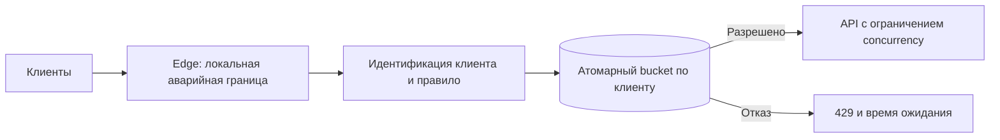

# Distributed rate limiter

## Требования

Ограничить tenant/user/API по requests или weighted cost, допустить controlled burst, вернуть решение за малую latency (срок ответа). Уточнить global accuracy, fairness, fail-open/closed, config propagation и analytics.

## Контракт

Input: identity, rule, cost, timestamp/context. Output: allowed, remaining estimate, reset/retry time и reason. Policy хранится versioned; decision state scoped так, чтобы один tenant не влиял на другого.

## Algorithm alternatives

- token bucket: refill rate + capacity, хороший default для burst;
- fixed/sliding window: проще reporting, разные boundary/space costs;
- concurrency limit: защищает длительную работу лучше request rate;
- hierarchical limiter: global → tenant → endpoint.

## Архитектура

Edge local bucket даёт низкую latency, но global overshoot пропорционален instances. Central Redis atomic script/function точнее, но добавляет network hop/hot key. Token leasing выделяет каждому node порцию global budget и ограничивает overshoot ценой менее точного использования.

## Отказы

При Redis/coordination outage security/cost rule может fail-closed, availability (доступность заявленной операции) rule — bounded (с явным конечным пределом) fail-open с local emergency limit. Clock skew не должен позволять отрицательный/огромный refill; server-side time или monotonic local lease (временное право владения) уменьшает риск. Config rollout включает version, а не instant mutation без audit.

## Масштабирование

Shard (часть данных у отдельного владельца) state по limiter key, отдельно решая global cap. TTL (время жизни записи) удаляет inactive keys; cardinality/attack на новые identities ограничивается. Наблюдайте allowed/rejected, decision latency, overshoot estimate, hot keys и downstream saturation (насыщение ресурса и образование очереди).

## Компромиссы

Абсолютно точный global limit требует coordination и снижает availability. Для capacity часто достаточно bounded overshoot; для финансовой quota может требоваться authoritative (владеющий достоверным состоянием) reservation ledger.

## Учебная схема и числа

Пусть API обрабатывает 100 000 запросов/с, 100 узлов, лимит клиента 100/с с запасом 200 токенов. Если каждый узел выдаёт полную квоту, клиент через все узлы получит до 10 000/с. Локальный limiter правильный только для локальной квоты либо приблизительной защиты. Централизованное решение добавляет до 100 000 операций/с к хранилищу решений, ещё до бизнес-запросов.



### Атомарная арифметика bucket

Состояние `(tokens,last_time)` меняем одной атомарной операцией:

```text
elapsed = max(0, now - last_time)
tokens = min(capacity, tokens + rate * elapsed)
allowed = tokens >= cost
if allowed: tokens -= cost
last_time = max(now, last_time)
retry_after = max(0, (cost - tokens) / rate)  # для отклонённого запроса
```

При `cost > capacity` запрос никогда не пройдёт: это отдельная ошибка политики, а не бесконечный Retry-After. Целочисленные единицы/фиксированная точность исключают накопление ошибки float. TTL должен быть не меньше времени полного восстановления bucket; преждевременное удаление возвращает полный burst.

### Квоты пачками и failover

При token leasing узел резервирует, например, 50 токенов у общей власти и тратит их локально. Потеря узла оставляет неиспользованный остаток: его нельзя немедленно повторно выдать и одновременно позволить старому узлу продолжать. Либо токены окончательно списаны при выделении (недоиспользование), либо lease имеет срок/epoch и после смены владельца старый расход блокируется. Верхняя граница доступного одновременно локального запаса при 100 узлах × 50 — 5 000 токенов; это запас поверх скорости refill, а не универсальная точность лимита.

Сбой: асинхронный Redis failover теряет недавнее списание. Лимит становится мягче; для финансовой квоты нужен durable ledger резервов, для защиты API может быть допустим аварийный локальный потолок. Различаем ограничение частоты и одновременной работы: 100/с с длительностью 10 s означает около 1 000 активных запросов.

## Источник механизма

[RFC 6585: 429](https://www.rfc-editor.org/rfc/rfc6585.html#section-4). Числа и topology в примерах — учебные допущения, не параметры этой системы.

## Проверь себя

1. Почему локальный лимит умножается на число узлов?
2. Почему rate limiter не спасает от медленных запросов?
3. Что выбрать при недоступности хранилища?

<details>
<summary>Ориентиры для ответа</summary>

1. Каждый независимо выдаёт бюджет одному клиенту.
2. Он считает начало работы, а не длительность и занятые ресурсы.
3. Решение по риску: платёжная квота требует отказа, обычный API может принять ограниченный локальный бюджет.

</details>
