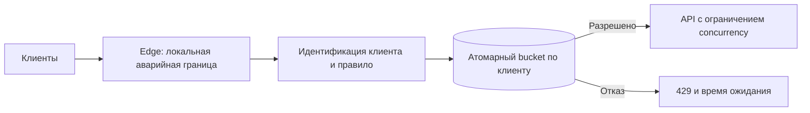

# Общий ограничитель запросов

Общий ограничитель должен выдавать одну квоту клиенту, даже когда запросы идут через множество серверов. Иначе масштабирование незаметно умножит разрешённую нагрузку.

## Как устроено

Сначала определяют владельца квоты и стоимость операций. Ведро токенов хранит остаток и время пополнения. Проверка, пополнение и списание выполняются одной атомарной операцией, иначе параллельные запросы потратят один запас несколько раз.

Общий учёт добавляет обращение к хранилищу для каждого решения. Чтобы уменьшить расходы, узлам можно выдавать заранее списанные порции, учитывая потерю неиспользованного остатка и действия старого узла.

При отказе учёта нужно выбрать политику: для финансовой квоты обычно недопустимо произвольное превышение; для защиты API можно оставить аварийный местный потолок. Частота начала запросов не ограничивает число долгих активных операций, поэтому нужен отдельный предел параллелизма.

## Учебная схема и числа

Пусть API обрабатывает 100 000 запросов/с, 100 узлов, лимит клиента 100/с с запасом 200 токенов. Если каждый узел выдаёт полную квоту, клиент через все узлы получит до 10 000/с. Локальный ограничитель правильный только для локальной квоты либо приблизительной защиты. Централизованное решение добавляет до 100 000 операций/с к хранилищу решений, ещё до бизнес-запросов.



### Атомарный расчёт запаса

Состояние `(tokens,last_time)` меняем одной атомарной операцией:

```text
elapsed = max(0, now - last_time)
tokens = min(capacity, tokens + rate * elapsed)
allowed = tokens >= cost
if allowed: tokens -= cost
last_time = max(now, last_time)
retry_after = max(0, (cost - tokens) / rate)  # для отклонённого запроса
```

При `cost > capacity` запрос никогда не пройдёт: это отдельная ошибка политики, а не бесконечный Retry-After. Целочисленные единицы/фиксированная точность исключают накопление ошибки float. Срок хранения записи должен быть не меньше времени полного восстановления запаса; преждевременное удаление возвращает полный разовый запас.

### Квоты порциями и переключение после отказа

При выдаче порций квоты узел резервирует, например, 50 токенов у общей власти и тратит их локально. Потеря узла оставляет неиспользованный остаток: его нельзя немедленно повторно выдать и одновременно позволить старому узлу продолжать. Либо токены окончательно списаны при выделении (недоиспользование), либо право имеет срок и номер поколения и после смены владельца старый расход блокируется. Верхняя граница доступного одновременно локального запаса при 100 узлах × 50 — 5 000 токенов; это запас поверх скорости пополнения, а не универсальная точность лимита.

Сбой: переключение Redis с асинхронной репликацией теряет недавнее списание. Лимит становится мягче; для финансовой квоты нужен сохраняемый журнал резервов, для защиты API может быть допустим аварийный локальный потолок. Различаем ограничение частоты и одновременной работы: 100/с с длительностью 10 секунд означает около 1 000 активных запросов.

## Источник механизма

[RFC 6585: 429](https://www.rfc-editor.org/rfc/rfc6585.html#section-4). Числа в примере учебные; реальную нагрузку и размеры нужно измерить.

## Проверь себя

1. Почему локальный лимит умножается на число узлов?
2. Почему ограничитель частоты не спасает от медленных запросов?
3. Что выбрать при недоступности хранилища?

<details>
<summary>Ориентиры для ответа</summary>

1. Каждый независимо выдаёт бюджет одному клиенту.
2. Он считает начало работы, а не длительность и занятые ресурсы.
3. Решение по риску: платёжная квота требует отказа, обычный API может принять ограниченный локальный бюджет.

</details>
