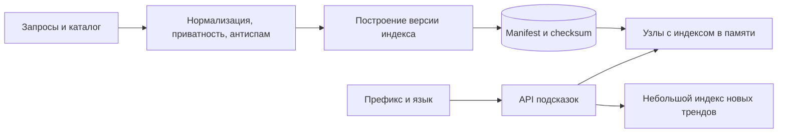

# Search autocomplete

## Требования

Вернуть top suggestions по prefix за десятки миллисекунд, с locale, typo/personalization и freshness. Уточнить corpus, QPS (число запросов в секунду) per keystroke, minimum prefix, unsafe terms, deletion/privacy и ranking signals.

## Поток данных

Query/click/catalog events поступают в stream; batch/stream jobs normalize-ят text, aggregate counts, фильтруют abuse и строят versioned prefix → top-K artifact. Build публикуется атомарно через manifest/version; nodes загружают новый immutable index и держат предыдущий для rollback (отмена локальной транзакции или возврат старой версии).

## Структуры выдачи

- trie/FST хорошо разделяет prefixes и сжимает sorted lexicon;
- key-value `locale:prefix → top K` даёт простой lookup, но materialize-ит много prefixes;
- search engine completion index поддерживает richer analysis ценой отдельного cluster.

Держите top K на node/local cache; не сканируйте full corpus per keystroke. Shard (часть данных у отдельного владельца) по locale/first normalized symbols, учитывая skew пустых/коротких prefixes.

## Ранжирование

Score сочетает popularity decay, business quality, locale/context и optional user history. Персонализацию лучше merge-ить из малого user candidate (кандидат на лидерство) set, чтобы не материализовать index на каждого user. Stable tie-breaker делает results детерминированными.

## Freshness и failures

Base index обновляется batch, realtime delta добавляет тренды; merge ограничивает размер delta и допускает fallback на base. Failed build не должен заменить healthy version. Cache key включает index/model version.

## Security/quality

Не показывайте редкие private queries, PII (персональные данные) и banned suggestions. Rate limit per user/IP, minimum prefix и server debounce снижают enumeration/QPS. Наблюдайте p99 (время, в которое укладывается 99% наблюдений), zero-result, click-through, index age/load failures и distribution prefixes.

## Компромиссы

Больше freshness/personalization повышает cost и privacy risk. Typo tolerance на очень коротком prefix резко расширяет candidates; часто её включают позже.

## Схема и оценки

Допустим, 1 млн поисковых сессий/сутки по 8 запросов подсказки: 8 млн/сутки ≈ 93/с, пик ×20 ≈ 1 852/с. 10 млн материализованных префиксов, 10 ID по 8 B на каждый — 800 MB только ID. Строки, оценки, словарь, указатели и два индекса во время обновления увеличат память; замеряем реальную структуру, не приравниваем к этому минимуму.

### Префиксы, язык и стоимость

Нормализуем Unicode и регистр согласованно при построении и чтении. Нельзя обрезать UTF-8 по байтам и считать результат символом. Для русского отдельно выбираем семантику «е/ё», транслитерации и опечаток: разные правила дают разные кандидаты. Trie — дерево символов, общий префикс хранится один раз; FST сжимает повторяющиеся переходы, но его стоимость зависит от словаря. Короткий префикс имеет огромную выдачу: заранее храним только top-K, а не перебираем все слова.

### Обновление без смешения версий

Build формирует неизменяемый артефакт со словарём/оценками/checksum и версией анализатора. Узел сначала скачивает и проверяет, затем атомарно меняет указатель на индекс. Старый остаётся для выполняющихся запросов и rollback. Cache key включает язык и версию; иначе после обновления узел продолжит показывать старые ответы из кэша.

Delta содержит новые тренды, а список запретов проверяется при окончательной выдаче независимо от возраста base index. Иначе удалённое чувствительное выражение вернётся из вчерашнего файла. Сбой: неполный build или нарушенная checksum — новая версия не активируется. Работаем на прежней с метрикой возраста индекса; отсутствие актуальности показываем как деградацию, а не успешное обновление.

## Источник механизма

[Unicode normalization](https://www.unicode.org/reports/tr15/). Числа и topology в примерах — учебные допущения, не параметры этой системы.

## Проверь себя

1. Почему нельзя делать поиск по всем строкам на каждую букву?
2. Как обновить индекс без половины новых данных?
3. Почему запреты нужны отдельно от batch index?

Ориентиры для ответа

1. Число запросов умножается на ввод; короткий префикс слишком широк.
2. Загрузить целый проверенный артефакт и атомарно переключить версию.
3. Удаление нельзя ждать до следующего полного построения.

