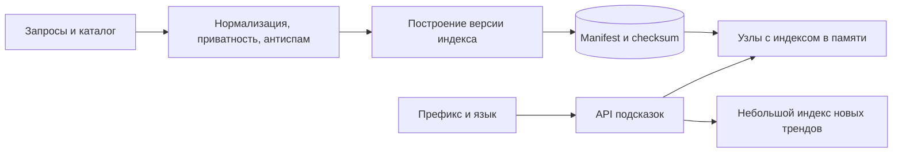

# Поисковые подсказки: быстрый ответ на короткий префикс

При вводе каждой буквы пользователь запрашивает подсказку. Короткий префикс подходит миллионам строк, поэтому полный поиск по каталогу для каждого нажатия слишком дорог.

## Как устроено

Заранее строят словарь и список лучших вариантов для популярных префиксов. Индекс хранится в памяти или доступном быстром представлении. На запросе нормализуют язык и регистр так же, как при построении.

Индекс обновляют целой проверенной версией: сначала загружают файл и проверяют целостность, затем атомарно переключают указатель. Старые запросы продолжают использовать прежнюю версию. Небольшой дополнительный индекс позволяет быстрее учитывать новые тренды.

Удаление опасной или персональной подсказки нельзя откладывать до следующего полного построения. Список запретов проверяют перед выдачей. Размер индекса считают с текстом, оценками и временным сосуществованием двух версий, а не только по числу ID.

## Схема и оценки

КиБ — 1024 байта; МБ, ГБ и ТБ здесь обозначают миллион, миллиард и триллион байтов. Допустим, 1 млн поисковых сессий/сутки по 8 запросов подсказки: 8 млн/сутки ≈ 93/с, пик ×20 ≈ 1 852/с. 10 млн материализованных префиксов, 10 ID по 8 байт на каждый — 800 МБ только ID. Строки, оценки, словарь, указатели и два индекса во время обновления увеличат память; замеряем реальную структуру, не приравниваем к этому минимуму.

### Префиксы, язык и стоимость

Нормализуем Unicode и регистр согласованно при построении и чтении. Нельзя обрезать UTF-8 по байтам и считать результат символом. Для русского отдельно выбираем семантику «е/ё», транслитерации и опечаток: разные правила дают разные кандидаты. Trie — дерево символов, общий префикс хранится один раз; FST сжимает повторяющиеся переходы, но его стоимость зависит от словаря. Короткий префикс имеет огромную выдачу: заранее храним только K лучших вариантов, а не перебираем все слова.

### Обновление без смешения версий

Процесс построения формирует неизменяемый артефакт со словарём, оценками и контрольной суммой и версией анализатора. Узел сначала скачивает и проверяет, затем атомарно меняет указатель на индекс. Старый остаётся для выполняющихся запросов и rollback. Ключ кэша включает язык и версию; иначе после обновления узел продолжит показывать старые ответы из кэша.

Дополнительный индекс содержит новые тренды, а список запретов проверяется при окончательной выдаче независимо от возраста основного индекса. Иначе удалённое чувствительное выражение вернётся из вчерашнего файла. Сбой: неполный построение или неверная контрольная сумма — новая версия не активируется. Работаем на прежней с метрикой возраста индекса; отсутствие актуальности показываем как деградацию, а не успешное обновление.

## Источник механизма

[Unicode normalization](https://www.unicode.org/reports/tr15/). Числа в примере учебные; реальную нагрузку и размеры нужно измерить.

## Проверь себя

1. Почему нельзя делать поиск по всем строкам на каждую букву?
2. Как обновить индекс без половины новых данных?
3. Почему запреты нужны отдельно от индекса, построенного пакетом?

Ориентиры для ответа

1. Число запросов умножается на ввод; короткий префикс слишком широк.
2. Загрузить целый проверенный артефакт и атомарно переключить версию.
3. Удаление нельзя ждать до следующего полного построения.

