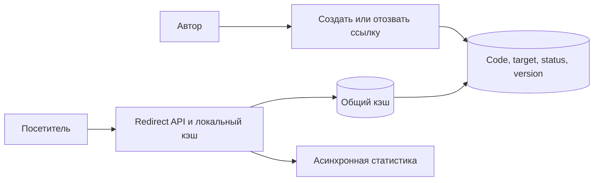

# URL shortener

## Требования

Создать short code для valid destination, быстро redirect-ить, поддержать expiry/revoke и optional custom alias. Уточнить redirect status (`301` cache-ится агрессивно, `302/307` позволяет менять target), privacy, click analytics и abuse/takedown.

## Оценка ёмкости

Read/write ratio обычно высокий. Оцените links/day × retention (срок хранения) × bytes и peak redirect QPS (число запросов в секунду); hot viral code важнее average. Redirect p99 (время, в которое укладывается 99% наблюдений) и availability (доступность заявленной операции) — primary SLO (цель качества сервиса за заданное окно), analytics может отставать.

## Модель и API

`links(code PK, owner, destination, created_at, expires_at, status, version)`. `POST /links` принимает idempotency key; `GET /{code}` возвращает redirect; revoke — conditional update. Не позволяйте open redirect использовать внутренние/private schemes/addresses без policy.

## Способы получения кода

- random Base62: decentralized, collision проверяется unique insert; длина задаёт пространство и enumeration risk;
- sequence/Snowflake → Base62: нет collision, но коды предсказуемы и нужен ID allocation;
- hash URL: одинаковый URL может давать один code, но collisions, ownership (владение данными или ответственность за ресурс) и mutable options усложняют contract (договорённость о поведении и гарантиях).

## Пути запросов

Write валидирует → генерирует code → authoritative (владеющий достоверным состоянием) DB commit (фиксация результата, который считается подтверждённым) → cache fill/invalidate. Read edge/service проверяет cache → DB → status/expiry → redirect. Click event публикуется asynchronous с sampling/idempotency; не блокирует redirect.

## Scale и failures

Cache-aside защищает DB, local/CDN cache — hot codes; revoke требует короткого max-stale или versioned purge. Shard (часть данных у отдельного владельца) по code hash, но custom aliases требуют той же unique authority. При cache outage ограничьте DB concurrency. DB failover должен сохранять confirmed creations; ambiguous create возвращается по idempotency key.

## Компромиссы

Longer code уменьшает collision, но хуже UX. Strong revoke снижает cacheability. Exact click counter дороже event log/approximate analytics. Не храните секретный access control только в непредсказуемости URL.

## Схема и проверка размера

Учебный масштаб: 1 млн новых ссылок/сутки, 100 млн переходов, год хранения. Это 11,6 записей/с и 1 157 чтений/с в среднем; пик ×10 даёт 116 и 11 570/с. 365 млн строк по 300 B — 109,5 GB полезных данных без индексов/реплик. Пространство восьми символов Base62: `62^8 ≈ 2,18×10^14`. Для 365 млн случайных кодов ожидаемое число столкнувшихся пар примерно `n(n-1)/(2M) ≈ 305`: уникальная вставка и повтор генерации обязательны даже при большом пространстве.

### Создание и перенаправление

Уникальность кода проверяет БД, предварительный `SELECT` не защищает от гонки двух авторов. Для повторного POST после потерянного ответа ID операции возвращает прежний code. Alias и случайный code проходят одну власть уникальности. Для редиректа разрешаем `http/https`, запрещаем перевод строки в заголовке и контролируем вредоносные назначения. SSRF возникает, если сервис сам загружает preview/сканирует URL: проверять нужно также фактический IP после DNS и редиректы.

`301` и `308` допускают кэширование постоянного перенаправления по HTTP-правилам; это конфликтует с быстрым отзывом уже закэшированной ссылки. `302/307` тоже могут кэшироваться при явной политике, поэтому статус сам по себе не запрет кэша. `307` сохраняет метод; обычный переход браузера по GET этого различия не показывает. [RFC 9110](https://www.rfc-editor.org/rfc/rfc9110.html).

### Отзыв и горячая ссылка

Если обещаем «отзыв за 30 секунд», задаём верхнюю границу жизни кэша на всех слоях и доставку invalidation, а не только TTL (время жизни записи) Redis. После удаления запись удаления (tombstone) предотвращает случайное переиспользование старого кода: старые закладки не должны вести к чужому адресу. Вирусная ссылка обслуживается локально/CDN; её популярность не распределится добавлением обычных DB shards.

Сбой: Redis потерян, все 11 570 запросов/с идут в БД. Ограничиваем загрузки, объединяем одновременные miss одного кода, сохраняем разрешённые локальные значения. Статистика может потерять часть событий в best-effort режиме; если она нужна для биллинга, делаем отдельный durable путь и не называем его бесплатным.

## Проверь себя

1. Почему большое пространство не исключает столкновения?
2. Почему нельзя немедленно переиспользовать удалённый code?
3. Где возникает SSRF?

Ориентиры для ответа

1. Работает эффект дней рождения; проверка уникальности остаётся обязательной.
2. Старые ссылки и кэши приведут пользователя к новому владельцу.
3. При серверной загрузке назначения, а не от одного возврата Location браузеру.

