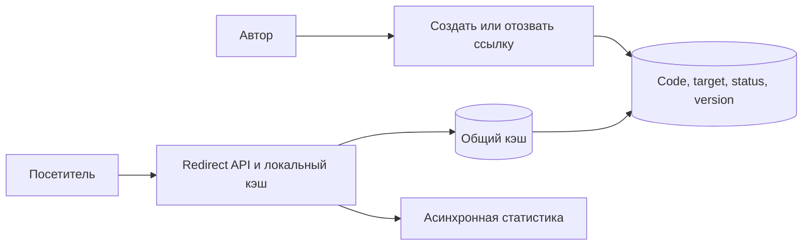

# Короткие ссылки: создание, переход и отзыв

Короткая ссылка сопоставляет небольшой код с полным адресом. Создание редкое, переходы частые; одна популярная ссылка может дать большую часть нагрузки.

## Как устроено

БД обеспечивает уникальность кода. При случайной генерации возможны столкновения, поэтому вставка проверяется уникальным ограничением и при конфликте генерируется новый код. Повтор создания после потери ответа возвращает прежний результат по ID операции.

Переход читает адрес и проверяет срок и статус. Кэш ускоряет горячие ссылки, но усложняет отзыв: копии браузера и промежуточных узлов могут жить дольше записи Redis. Конкретная политика HTTP определяет допустимое хранение.

Статистику кликов можно обрабатывать отдельно, чтобы она не замедляла переход. Если она нужна для оплаты, нужен сохраняемый и проверяемый путь. Непредсказуемость короткого кода не заменяет права доступа к защищённому содержимому.

## Схема и проверка размера

КиБ — 1024 байта; МБ, ГБ и ТБ здесь обозначают миллион, миллиард и триллион байтов. Учебный масштаб: 1 млн новых ссылок/сутки, 100 млн переходов, год хранения. Это 11,6 записей/с и 1 157 чтений/с в среднем; пик ×10 даёт 116 и 11 570/с. 365 млн строк по 300 байт — 109,5 ГБ полезных данных без индексов/реплик. Пространство восьми символов Base62: `62^8 ≈ 2,18×10^14`. Для 365 млн случайных кодов ожидаемое число столкнувшихся пар примерно `n(n-1)/(2M) ≈ 305`: уникальная вставка и повтор генерации обязательны даже при большом пространстве.

### Создание и перенаправление

Уникальность кода проверяет БД, предварительный `SELECT` не защищает от гонки двух авторов. Для повторного POST после потерянного ответа ID операции возвращает прежний код. Alias и случайный код проходят одну власть уникальности. Для редиректа разрешаем `http/https`, запрещаем перевод строки в заголовке и контролируем вредоносные назначения. SSRF возникает, если сервис сам загружает preview/сканирует URL: проверять нужно также фактический IP после DNS и редиректы.

`301` и `308` допускают кэширование постоянного перенаправления по HTTP-правилам; это конфликтует с быстрым отзывом уже закэшированной ссылки. `302/307` тоже могут кэшироваться при явной политике, поэтому статус сам по себе не запрет кэша. `307` сохраняет метод; обычный переход браузера по GET этого различия не показывает. [RFC 9110](https://www.rfc-editor.org/rfc/rfc9110.html).

### Отзыв и горячая ссылка

Если обещаем «отзыв за 30 секунд», задаём верхнюю границу жизни кэша на всех слоях и доставку invalidation, а не только срок жизни записи Redis. После удаления запись удаления (tombstone) предотвращает случайное переиспользование старого кода: старые закладки не должны вести к чужому адресу. Вирусная ссылка обслуживается локально/CDN; её популярность не распределится добавлением обычных шардов БД.

Сбой: Redis потерян, все 11 570 запросов/с идут в БД. Ограничиваем загрузки, объединяем одновременные промахи кэша одного кода, сохраняем разрешённые локальные значения. Статистика может потерять часть событий в режиме без гарантии сохранения; если она нужна для биллинга, делаем отдельный сохраняемый путь и не называем его бесплатным.

## Проверь себя

1. Почему большое пространство не исключает столкновения?
2. Почему нельзя немедленно переиспользовать удалённый код?
3. Где возникает SSRF?

Ориентиры для ответа

1. Работает эффект дней рождения; проверка уникальности остаётся обязательной.
2. Старые ссылки и кэши приведут пользователя к новому владельцу.
3. При серверной загрузке назначения, а не от одного возврата Location браузеру.

