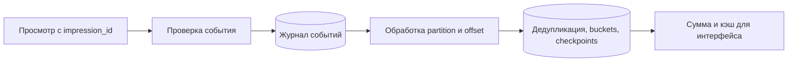

# View counter

## Требования

Считать page/video/ad views и показывать total. Сначала определить view: request, authenticated user/day, watch duration, bot-filtered impression? Нужны exact billing numbers или approximate social proof, и как быстро обновление видно?

## Alternatives

- atomic counter в DB/Redis: просто, но viral item — hot key (ключ с непропорционально высокой нагрузкой);
- sharded counters `(content_id, shard)` с sum on read/materialization;
- append events в Kafka, stream aggregation и durable rollups;
- probabilistic distinct counter для unique users с известной ошибкой.

## Проектирование

Edge/API валидирует event и stable impression ID → broker partitioned по content ID или hash → consumers deduplicate (устранять повторы) в bounded (с явным конечным пределом) window → aggregate minute/hour buckets → query service складывает durable rollup + recent delta/cache.

Partition (раздел журнала или данных; при network partition — разрыв связи) по content ID сохраняет order, но один viral content перегружает partition. Добавление random subshard распределяет writes, ценой merge и отсутствия единого order. Exact dedup требует хранить каждый impression ID; approximate Bloom/HLL уменьшают storage и добавляют error.

## Отказы

At-least-once broker даёт duplicates, producer timeout — ambiguous acceptance, late events приходят после закрытия bucket. Определите lateness/watermark и correction path. Потеря cache не должна терять durable count; rebuild из retained events/rollups проверяется.

## Компромиссы

Для UI допускается eventual approximate count и batching. Для billing нужен immutable event/audit, строгая identity, reconciliation (сверка и устранение расхождений) и часто отдельный pipeline. Не заставляйте один counter удовлетворять обеим semantics.

## Observability

Event acceptance/drop/duplicate rate, consumer (потребитель работы или контракта) lag, hot partitions, correction volume и расхождение raw sample с rollups.

## Нагрузка и поток данных

Учебный пример: 100 млн просмотров/сутки ≈ 1 157/с, пик ×10 ≈ 11 570/с. Событие 100 B занимает 10 GB/сутки; семь дней — 70 GB до реплик и служебных расходов. Хранить уникальный ID каждого события дорого, но для точного устранения повторов эти данные должны где-то существовать в пределах окна.

### Durable сумма и позиция

Consumer собирает пакет. В одной транзакции вставляет новые `(impression_id)` в inbox (записи уже применённых событий для защиты от повторов), увеличивает счётчики только для действительно новых ID и сохраняет обработанную позицию partition. Затем подтверждает offset брокеру. Падение до commit (фиксация результата, который считается подтверждённым) оставляет всё неприменённым; после commit до подтверждения — повтор видит сохранённый checkpoint/ID и не прибавляет снова. Отдельно сохранённый checkpoint (сохранённая позиция завершённой обработки) может пропустить ещё не записанную сумму.

Для миллиарда событий в сутки это может быть слишком дорого. Альтернатива — сумма по `(partition, bucket)` с заменой детерминированного результата, либо потоковый движок с согласованным состоянием и checkpoint. Важна граница атомарности, а не название технологии. Kafka транзакция сама не делает внешний PostgreSQL UPDATE атомарным с offset.

### Повторный расчёт и поздние события

Событие имеет время просмотра и время приёма. Счётчик по календарному часу использует время события; запоздавшие события корректируют закрытый bucket в разрешённом окне. Replay (повторное проигрывание сохранённых событий) строит новую таблицу/версию агрегатов, проверяет суммы и переключает читателей, а не запускает `count += delta` поверх старой суммы. Если сырые события уже удалены, точный пересчёт невозможен: сохраняем rollups и документируем предел восстановления.

HLL оценивает число разных пользователей, Bloom filter проверяет вероятное наличие ID; это разные задачи. Ложное срабатывание Bloom отбросит реальный новый просмотр, значит точная сумма станет заниженной. Сбой: Redis потерял буфер — при журнале как источнике истины его можно восстановить, при единственном Redis INCR подтверждённые просмотры могут исчезнуть. Для UI и оплачиваемых показов нужны разные договорённости о точности.

## Источник механизма

[Kafka 4.3 design: delivery semantics](https://kafka.apache.org/43/design/design/). Числа и topology в примерах — учебные допущения, не параметры этой системы.

## Проверь себя

1. Почему сумма и checkpoint должны сохраняться вместе?
2. Как повторно посчитать историю?
3. Можно ли считать HLL точным счётчиком событий?

Ориентиры для ответа

1. Иначе повтор удвоит сумму или переход позиции потеряет часть просмотров.
2. В новой версии агрегатов, с последующей сверкой и переключением.
3. Нет, это приближённая оценка числа различных элементов.

