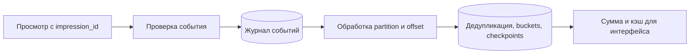

# Счётчик просмотров: что считать и как пережить повтор

Сначала определите просмотр: открытие страницы, уникальный человек за день или оплачиваемый показ. Эти определения требуют разных данных и точности.

## Как устроено

В простой модели каждый просмотр увеличивает число. Один популярный объект становится горячей точкой; журнал событий и частичные суммы позволяют распределить запись. Но повторная доставка может удвоить результат.

Для точности сохраняют ID события, изменение суммы и позицию обработки вместе. После падения повтор распознаётся. Позиция, сохранённая раньше суммы, потеряет работу; сумма, сохранённая без защиты повторов, увеличится дважды. Транзакция Kafka сама не объединяет внешний UPDATE PostgreSQL с подтверждением журнала.

Поздние события и повторный расчёт требуют политики времени и версии агрегата. Публичное число может допускать приближение; оплачиваемые показы обычно требуют отдельного журнала и сверки.

## Нагрузка и поток данных

Байт — единица размера данных; ГБ здесь равен миллиарду байтов. Учебный пример: 100 млн просмотров/сутки ≈ 1 157/с, пик ×10 ≈ 11 570/с. Событие 100 байт занимает 10 ГБ/сутки; семь дней — 70 ГБ до реплик и служебных расходов. Хранить уникальный ID каждого события дорого, но для точного устранения повторов эти данные должны где-то существовать в пределах окна.

### Сумма и позиция, сохраняемые вместе

Получатель собирает пакет. В одной транзакции вставляет новые `(impression_id)` в таблицу обработанных ID (inbox), увеличивает счётчики только для действительно новых ID и сохраняет обработанную позицию раздела журнала. Затем подтверждает позицию брокеру. Падение до завершения транзакции оставляет всё неприменённым; после завершения транзакции до подтверждения — повтор видит сохранённую позицию/ID и не прибавляет снова. Отдельно сохранённый позиция завершённой обработки может пропустить ещё не записанную сумму.

Для миллиарда событий в сутки это может быть слишком дорого. Альтернатива — сумма по паре `(раздел журнала, временной интервал)` с заменой детерминированного результата, либо потоковый движок с согласованным состоянием и сохранённой позицией обработки. Важна граница атомарности, а не название технологии. Kafka транзакция сама не делает внешний PostgreSQL UPDATE атомарным с подтверждением позиции.

### Повторный расчёт и поздние события

Событие имеет время просмотра и время приёма. Счётчик по календарному часу использует время события; запоздавшие события корректируют закрытый временной интервал в разрешённом окне. Повторный расчёт строит новую таблицу/версию агрегатов, проверяет суммы и переключает читателей, а не запускает `count += delta` поверх старой суммы. Если сырые события уже удалены, точный пересчёт невозможен: сохраняем итоговые суммы и документируем предел восстановления.

HyperLogLog (HLL) оценивает число разных пользователей, фильтр Блума проверяет вероятное наличие ID; это разные задачи. Ложное срабатывание Bloom отбросит реальный новый просмотр, значит точная сумма станет заниженной. Сбой: Redis потерял буфер — при журнале как источнике истины его можно восстановить, при единственном Redis INCR подтверждённые просмотры могут исчезнуть. Для UI и оплачиваемых показов нужны разные договорённости о точности.

## Источник механизма

[Kafka 4.3 design: delivery semantics](https://kafka.apache.org/43/design/design/). Числа в примере учебные; реальную нагрузку и размеры нужно измерить.

## Проверь себя

1. Почему сумма и позиция обработки должны сохраняться вместе?
2. Как повторно посчитать историю?
3. Можно ли считать HLL точным счётчиком событий?

Ориентиры для ответа

1. Иначе повтор удвоит сумму или переход позиции потеряет часть просмотров.
2. В новой версии агрегатов, с последующей сверкой и переключением.
3. Нет, это приближённая оценка числа различных элементов.

